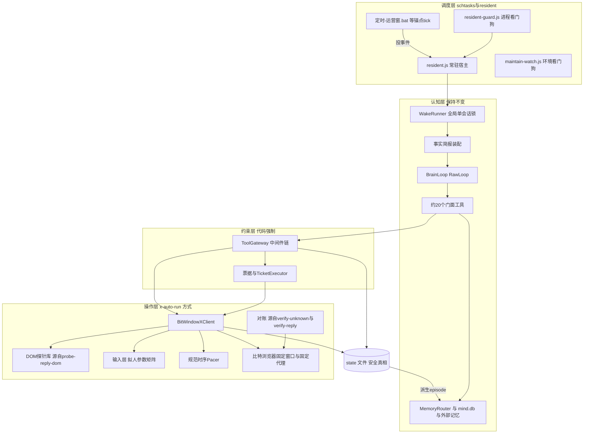

③ · 完成。项目目录已清理干净（只剩 docs/），全程只读。以下为本岗答卷全文。

---

# 来源：Cursor Agent（模型 claude-opus-5-5-high，显式指定）· MoA 第五轮（认知层嫁接 x-auto-run 操作环节）· 2026-10-22

> ZCode 侧执行注记：任务经 cursor-agent CLI 在 E:\x-auto-runner 下以 --trust 执行；简报由本岗注入仓库事实底座（GitHub 抓取的文件清单、《规范与约束.md》约束摘录、调度拓扑）+ round4 评估中仍然有效的操作环节结论；产出 62024 字节，核验覆盖 ①-⑤ 全部设计问题、无业务目标评判跑偏、未写任何文件。临时文件已清理。

---

# 认知层嫁接 x-auto-run 操作环节：完整 agent 方案（cursor 岗 · 第五轮）

**执行说明**
- 全程只读，没有创建或修改任何文件。
- 认知层的来源：我精读了自己上轮的 `cursor-opus-5.5.md` 全文，也读了 kimi、glm、gemini、grok 四份方案的记忆、画像、决策循环、风控、账本和调度章节。
- 唯一一次联网（抓取 `probe-reply-dom.js` 源码）被拒绝。所以 x-auto-run 的仓库事实全部取自简报 §4。凡是依赖脚本内部实现的地方，都标成假设 G-A1 起，集中在 §11，开工第一天读源码核对。
- 文中说"规范"指《规范与约束.md》。说"五份方案"指 round3 的 kimi、glm、cursor、gemini、grok。

---

## 0. 执行摘要

1. **嫁接原则：脑子不变，手换成 x-auto-run 的手。**
   - 认知层整体保留：常驻自主运营者、事件唤醒、事实简报、约 20 个门面工具、工具边界网关、票据制审批、记忆与画像、夜整理、渐进放权、反退化纪律。
   - 换掉的只有"怎么驱动 X"。原来是 XActions 侧车 + MCP + Puppeteer 持久 Chrome 加降级链，现在是 x-auto-run 的做法：
     - 纯 JS 真实窗口脚本；
     - 比特浏览器固定窗口 + 固定代理；
     - DOM 探针；
     - `state/` 文件记账；
     - schtasks/.bat + resident 加看门狗；
     - 约束由代码强制；
     - `--dry` 演练。
2. **XClient 端口只有一个第一实现，`BitWindowXClient`。** 它就是 x-auto-run 现有窗口脚本能力的模块化封装。
   - 写操作不再有降级链。会话中途换通道就等于换指纹、换出口，违反"会话中途绝不换 IP"。
   - 端口保留，将来可以插别的实现，但第一实现不做。
3. **单一 Node.js 运行时。** 大脑循环、网关、手、账本、调度都在同一个 Node 进程族里，进程内函数调用，没有侧车，内部也没有 MCP。
   - 大脑循环内核放在 `BrainLoop` 端口后面，默认用在 `llm.js` 上扩展的约 200 行自研 RawLoop。
   - 认知层的设计不变，变的只是宿主语言。
4. **两层账本，两套真相。**
   - `state/` 文件是**安全真相**：去重、计数、熔断、票据、打开记录、审计流。只有确定性代码能写。
   - `mind/` 记忆库是**叙事真相**：episode、画像叙述、案例、剧本、日志、交接笔记。Agent 通过工具写，夜整理也写。
   - 每个动作先落 `state/`，再派生 episode。月度 `log-YYYY-MM.jsonl` 是夜整理唯一的事实来源。
5. **调度统一。**
   - 运营窗 .bat 就是作息窗里的 tick，它只往队列里投事件。
   - resident.js 负责事件唤醒和 `next_wake_hint` 定时。`next_wake_hint` 被钳制在 09:00–22:00 内，并且要满足会话间隔和每日会话数上限。
   - 夜整理和周复盘改为离线会话，不开窗。
   - `--dry` 和 `EXECUTOR_SIMULATE` 就是上轮"FakeX 演练世界"在现实里的等价物。
6. **约束数值冲突时，一律取更严者**（对照表见 §7）。例如：执行窗 09–22、单会话不超过 20 分钟、发帖间隔不少于 180 分钟、unknown 绝不重发、前 14 天不发原创。

---

## 1. 嫁接总图



---

## 2. ① 认知层与操作层的契约

### 2.1 分层与语言

- 契约写在 `types/*.d.ts` 里，实现是带 `// @ts-check` 和 JSDoc 的纯 JS，保持 x-auto-run 的纯 JS 风格。
- 大脑只能看见门面工具，看不见 XClient。
- XClient 只被网关的 Execute 中间件和 TicketExecutor 调用。
- 窗口里的物理法则（热身、浏览对方主页、阅读停留、规范时序）都在 XClient 内部执行，不是流程节点。就像人的拇指，大脑不用逐个指挥。

### 2.2 XClient 端口定义

```ts
// types/xclient.d.ts
export type AccountId = string;                 // 与 state/<账号>.json、--account 参数同名
export type TweetId = string;
export type Surface = 'home_for_you' | 'home_following' | 'notifications'
                    | 'mentions' | 'search' | 'profile' | 'own_profile';
export type ActionKind = 'like' | 'reply' | 'post' | 'quote' | 'follow' | 'delete_own';
export type RunMode = 'live' | 'dry' | 'simulate';

export interface WindowPin {                    // 存于 state/<账号>.json，人工设定
  browserId: string;                            // 比特浏览器窗口 ID（固定）
  proxyFingerprint: string;                     // 代理 host:port:user 的哈希（固定）
  expectedHandle: string;                       // 登录校验：左侧导航 profile 链接
}

export interface XClient {
  readonly account: AccountId;
  readonly mode: RunMode;

  // 会话：开窗 → 代理钉校验 → 登录校验 → 主页热身 30–90s
  open(o: { sessionId: string; deadline: string }): Promise<SessionOpenResult>;
  close(reason: 'end_session' | 'timeout' | 'stop' | 'risk_toast' | 'error'): Promise<void>;

  // 感知（只读，全部写打开记录 sightings）
  feedOpen(surface: Surface, q?: string): Promise<FeedScreen>;
  feedNext(): Promise<FeedScreen>;
  openTweet(id: TweetId, o?: { withReplies?: boolean; maxReplies?: number }): Promise<TweetDetail>;
  viewProfile(handle: string): Promise<ProfileCard>;
  skim(minutes: number): Promise<SkimRaw>;

  // 行动（只接受网关签发的 WriteIntent，大脑不可直达）
  like(i: WriteIntent<'like'>): Promise<ActionOutcome>;
  reply(i: WriteIntent<'reply'>): Promise<ActionOutcome>;
  post(i: WriteIntent<'post'>): Promise<ActionOutcome>;

  // 探针与对账
  probe(set: 'session' | 'reply' | 'post' | 'like' | 'full'): Promise<ProbeReport>;
  verify(rec: LedgerIntent): Promise<VerifyResult>;
}

export interface SessionOpenResult {
  ok: boolean;
  failReason?: 'bitbrowser_offline' | 'proxy_pin_mismatch' | 'login_mismatch'
             | 'login_wall' | 'captcha' | 'nav_timeout';
  warmup: { durMs: number; cards: TweetCard[] };       // 热身首屏，进简报（只陈述事实）
  probe: ProbeReport;                                  // 会话级探针结果 → 能力裁决
}

export interface TweetCard {
  tweetId: TweetId;
  author: { handle: string; name: string; followers?: number };
  text: string;                                        // ≤280 字截断
  createdAt: string; ageMin: number;                   // DOM 的 <time datetime> 换算，非 LLM 自报
  metrics: { replies?: number; reposts?: number; likes?: number; views?: number };
  flags: { pinned: boolean; promoted: boolean; isReply: boolean; likedByMe: boolean };
  sighting: { sessionId: string; screenNo: number; shownAt: string; dwellMs: number; opened: boolean };
}

export interface WriteIntent<K extends ActionKind> {
  kind: K;
  idemKey: string;                                     // 网关生成：sess:{sid}:call:{tcid} 或 ticket:{id}
  target?: { tweetId: TweetId; author: string };
  text?: string; textHash?: string;
  tone?: 'safe' | 'interesting' | 'bold';              // 大脑自报，网关已复核
  issuedBy: 'gateway' | 'ticket_executor';
  grant: string;                                       // 网关签发的一次性许可（HMAC），XClient 校验
}
```

### 2.3 三态结果结构

成功、unknown、失败是三个正式状态。中止、演练、模拟是三个辅助状态，用来覆盖 STOP、`--dry` 和 `EXECUTOR_SIMULATE`。

```ts
export type ActionOutcome =
  | { status: 'success'; kind: ActionKind; idemKey: string; at: string;
      evidence: Evidence; tweetId?: TweetId }
  | { status: 'unknown'; kind: ActionKind; idemKey: string; at: string;
      reason: 'modal_closed_no_toast' | 'input_cleared_no_toast' | 'no_toast_timeout'
            | 'crash_after_intent' | 'button_state_unread';
      quotaConsumed: true; resend: 'never'; verifyPlan: ('t+10m' | 't+2h')[] }
  | { status: 'failed'; kind: ActionKind; idemKey: string; at: string;
      reason: 'risk_toast' | 'selector_missing' | 'composer_not_found'
            | 'target_gone' | 'nav_timeout' | 'not_logged_in';
      submitted: boolean; countsTowardBreaker: boolean; riskToastText?: string }
  | { status: 'aborted'; kind: ActionKind; idemKey: string; at: string;
      reason: 'stop_signal' | 'session_deadline'; submitted: false }
  | { status: 'dry'; kind: ActionKind; idemKey: string; wouldDo: object }
  | { status: 'simulated'; kind: ActionKind; idemKey: string; as: 'success' | 'unknown' | 'failed' };

export type Evidence =
  | { kind: 'success_toast'; text: string }                        // reply 和 post 唯一的成功依据
  | { kind: 'button_state'; before: 'like'; after: 'unlike'; rereadMs: number }  // like
  | { kind: 'verified'; via: 'own_profile' | 'conversation'; tweetId: TweetId };  // 对账补认
```

判定规则如下。它们由规范直接继承而来，代码强制执行。

| 动作 | 记为 success | 记为 unknown（占额度、绝不重发、不计熔断） | 记为 failed |
|---|---|---|---|
| reply | 只有成功 toast 一种依据 | 弹窗关闭或输入框清空但没有 toast；超时没有 toast；崩溃时残留了 intent | 风控 toast（出错、请稍后再试、try again）：当日停该号全部会话；找不到选择器或输入框（未提交）：计入同类连败 |
| post | 成功 toast；能从 toast 的"查看"链接拿到 tweetId 时一并记下（G-A4） | 同 reply | 同 reply |
| like | 点击后 1–2 秒回读按钮，状态由 like 翻成 unlike | 点击已派发但回读失败 | 按钮不存在、目标已删除（未提交） |

"质量门不合格一律拒发"发生在网关的 ContentLint，此时还没进 XClient，返回的是 `refused`，不属于上面三态。

### 2.4 大脑看到的结果（门面层翻译）

```json
{"ok": true,  "status": "success", "tool": "reply", "tweet": "1855…", "took_s": 96}
{"ok": null,  "status": "unknown", "tool": "reply",
 "note": "提交后没看到成功提示，结果不确定。额度已占用，系统不会重发；10 分钟和 2 小时后自动对账，结果进后续简报。不要再写同一条。"}
{"ok": false, "status": "refused", "code": "AUTHOR_14D", "detail": "你 11-01 主动回复过 @foo，同一作者 14 天内只回一次",
 "retry_after": "2026-11-15T09:00:00+08:00", "hint": "可以点赞（若 24h 出向额度允许）或不互动"}
```

### 2.5 原语到窗口操作的映射表

| 门面工具 | XClient 方法 | 比特浏览器窗口操作序列 | DOM 读写（探针 ID） | 规范时序与物理法则（内嵌） | 打开记录 |
|---|---|---|---|---|---|
| `feed_open(surface)` | `feedOpen` | 导航到 `/home`（切换 For you 或 Following 标签）、`/notifications`、`/search?q=&f=live`、`/<handle>`，等主列出现，做一次甩动滚动 | 读 `feed.cell`、`card.time`、`card.pinned`、`card.metrics` | 每屏停留 TLN（按字数），滚动甩动参数矩阵 | 每张可见卡写 `shown` |
| `feed_next()` | `feedNext` | 下滚一屏（2–5 个滚动事件，7% 概率微回滚） | 同上 | 同上 | 同上 |
| `read_tweet(id)` | `openTweet` | 导航到 `/<handle>/status/<id>`，按长度停留，可选下滚读 3–6 条热评 | `detail.main`、`detail.replies` | 阅读 TLN(18s, 0.5, 8s, 60s) | 写 `opened` |
| `user_profile(handle)` | `viewProfile` | 导航到 `/<handle>`，下滚 1–2 屏 | `profile.header`、`profile.counts`、`profile.pinned` | 规范规定"互动前浏览对方主页 20–45s" | 该作者标 `profile_viewed` |
| `notifications()` | `feedOpen('notifications')` | 导航 `/notifications`，可切到 `/notifications/mentions` | `notif.cell` | 同 feed | `shown` |
| `search(q, mode)` | `feedOpen('search', q)` | 导航到搜索 URL；不在搜索框里模拟打字（避免多余输入轨迹） | 同 feed | 同 feed | `shown` |
| `skim(min, focus)` | `skim` | 循环"滚动、停留"，**不点击任何按钮** | `feed.cell` | 时长不超过会话剩余时间；用 Flash 档出摘要 | `shown`（标 `skim`） |
| `like(id)` | `like` | ①没看过该作者主页就先浏览 20–45s；②目标卡不在当前 DOM 里就导航到单帖；③贝塞尔移动后点 `action.like`；④回读按钮 | `action.like`、`action.unlike` | 与上一个写动作的间隔取规范时序和网关 Rate 的较大值 | **前置**：本会话内 shown 且停留至少 3 秒 |
| `reply(id, text, tone)` | `reply` | ①浏览主页 20–45s；②打开单帖并阅读；③点 `action.reply`；④探针确认输入框；⑤拼音分块打字（块间检查 STOP）；⑥复核停顿；⑦**写 intent 并落盘**；⑧点提交；⑨用 toast 观察器判三态 | `reply.composer`、`reply.submit`、`toast.region` | 回复间隔高斯 45s±15s；打字和复核用参数矩阵；总输入不超过 90s | **前置**：本会话内 opened |
| `post(text)` | `post` | 导航 `/home`，点输入框，打字，写 intent，提交，判 toast，从 toast 链接拿 tweetId，拿不到就到自己主页回读补 | `post.composer`、`post.submit`、`toast.region`、`toast.link` | 总输入不超过 240s；发完停留 1–4 分钟（不立即离开） | — |
| `end_session(...)` | `close` | 空闲 5–20s 后经比特浏览器本地 API 关窗 | — | 会话 20 分钟硬顶，15 分钟起提示收尾 | 打开记录归档 |

还有 quote、follow、delete_own 三类：依照规范的"新动作类型默认关闭"，它们在 `config.json.actions.enabled` 里是 false。门面不暴露，网关也拒绝。要开启，先改规范，再改 config，见 §10。

### 2.6 probe-reply-dom.js 的角色：感知探针加写结果判定

把现有脚本的探测逻辑抽成库 `hand/probes/`，原脚本保留为诊断 CLI，内部改为调用这个库。它承担三个职责。

1. **能力裁决**，替代上轮 XActions 的 `list_tools()`。
   - 每次 `open()` 时跑 `session` 探针集，只读：导航 profile 链接、feed 卡片、时间戳、点赞按钮、回复入口。
   - 第一次写某类动作之前，跑该类的写前探针：输入框、提交按钮、toast 区域。
   - 结果写入 `state/capability-<账号>.json`。网关的 CapabilityProbe 中间件读这个文件：某类动作是 `unavailable` 就拒绝，原因码 `SELECTOR_UNHEALTHY`，同时告警。
   - 页面结构改版就在这里被发现，不会在写的时候盲点。
2. **感知结构化**：所有读原语都通过探针注册表里的选择器取数据，选择器集中维护在 `hand/probes/selectors.json`，带版本号。大脑永远看不到选择器，只看到 `TweetCard`。
3. **写结果判定**：toast 观察器 `probe.toast.watch(timeoutMs)` 返回 `success_toast`、`risk_toast`、`modal_closed`、`input_cleared` 或 `none`，再由 §2.3 的表映射成三态。成功文案和风控文案的词表放在 config 里（中英双语，G-A3）。

```ts
export interface ProbeReport {
  set: string; at: string; selectorsVersion: string; ok: boolean;
  checks: { name: string; ok: boolean; matched?: number; note?: string }[];
  capability: Partial<Record<ActionKind, 'available' | 'degraded' | 'unavailable'>>;
}
```

### 2.7 "只能赞已展示的帖"：打开记录机制

- **谁写**：只有手写。每次读原语渲染出卡片，手就往 `state/sightings/<账号>/<sessionId>.jsonl` 追加一行。

  ```json
  {"t":"2026-11-08T14:12:41+08:00","tweetId":"1855…","author":"@foo","surface":"home_for_you",
   "screen":3,"dwellMs":4200,"opened":false,"pinned":false,"createdAt":"2026-11-08T12:58:10+08:00"}
  ```

- **谁读**：网关的 TargetPolicy 中间件。like 要求本会话里有 `shown` 且停留不少于 3 秒；reply 要求本会话里有 `opened`。帖龄、是否置顶都取 sightings 里由 DOM 读出的值，**LLM 说"我看过了"不算数**（grok 的规则，现在落到了手上）。
- **防编造**：大脑传入的 tweetId 如果在 sightings 里不存在，直接拒绝，原因码 `NOT_SEEN`。
- **作用域**：只在当前会话有效。跨会话的赞必须重新看到，才对应"真人刷到才赞"。

---

## 3. ② 两层账本

### 3.1 定位

| | 安全真相 `state/` | 叙事真相 `mind/` |
|---|---|---|
| 回答什么问题 | 能不能做、做没做、做了几次 | 我是谁、我记得什么、我怎么看这个人 |
| 格式 | JSON、JSONL 文件（x-auto-run 原生），账号级文件锁，原子写（写临时文件再改名） | 用户记忆系统（主）；默认实现是 `mind-data/<账号>/mind.db`（SQLite、FTS5、嵌入向量） |
| 写者 | **只有确定性代码**：网关、Executor、手、采样器、health.js | Agent 通过记忆工具写；PostHook 写 episode 骨架；夜整理写 |
| 损坏处置 | 备份为 `.corrupt-<ts>` 后终止并告警（规范），不自动重建 | 可以从 `state/` 审计流重建事实骨架 |
| 是否可以被另一层改 | mind 永远不能改 state | state 可以派生 mind 的事实字段 |

### 3.2 `state/` 文件清单与读写关系

前 6 项沿用 x-auto-run，后面是新增。

| 文件 | 写者 | 读者 | 内容 |
|---|---|---|---|
| `state/<账号>.json` | Executor、日切程序 | 网关、简报、面板 | 窗口钉、阶段、当日 caps、used、reserved、各类熔断、dayStop、审核态、会话计数、健康等级 |
| `state/ledger-<账号>.json` | Executor | 网关（Rate、Budget）、崩溃恢复 | 滚动 24h 账本：reserve、intent、outcome 三段式记录 |
| `state/log-YYYY-MM.jsonl` | Executor（只追加） | 断言器、事实单生成器、面板、报告 | 每个动作一行（v2 字段见下） |
| `state/contacts-<账号>.json` | Executor 的 PostHook | TargetPolicy、画像合并 | 人维度的安全台账（poolCap 150、TTL 90 天）。新增 `lastActiveReplyAt`、`out24h`、`out7d`、`doNotEngage` |
| `state/health-snapshots/YYYY-MM-DD.json` | health.js | 网关（健康降级）、简报 | 四维自检结果、比特浏览器在线状态、代理钉 |
| 账号锁 `state/<账号>.lock` | 会话持有者 | 所有入口 | pid 加 30 分钟超时接管 |
| **新** `state/sightings/<账号>/*.jsonl` | 手 | TargetPolicy | 打开记录 |
| **新** `state/decisions-YYYY-MM.jsonl` | 网关 | 事实单、面板、退化监测 | 每次 allow、deny、defer、review 的原因码 |
| **新** `state/tickets-<账号>.json` | ReviewRouter、TicketExecutor、resident（代面板落定） | 网关、简报、面板 | 票据和预留 |
| **新** `state/capability-<账号>.json` | 探针 | 网关 | 能力裁决 |
| **新** `state/metrics/<账号>-YYYY-MM.jsonl` | 采样器（fxtwitter） | 事实单、简报、评估器 | 自发帖与回复的 2/8/24/48h 指标、粉丝快照 |
| **新** `state/queue/<账号>/*.json` | .bat、采样器、面板、TicketExecutor | resident | 唤醒事件，原子改名消费 |
| **新** `state/wake-plan-<账号>.json` | resident | resident（重启后恢复） | 已落地的 `next_wake_hint` 和 followup |
| **新** `state/STOP`、`state/PAUSE_WRITES`、`state/<账号>.STOP` | 人、熔断器 | 全部入口、手（打字块之间） | kill switch |
| **新** `state/global-session.lock` | WakeRunner | 所有入口 | 两号永不并行 |

`log-YYYY-MM.jsonl` 的 v2 行向下兼容原有字段（账号、任务、帖子、动作、时间），只新增字段：

```json
{"v":2,"ts":"2026-11-08T14:31:07.412+08:00","account":"aiwen","task":"agent","post":"1855…",
 "action":"reply","session":"s-1108-07","wake":"w-1108-07","call":"tc_9",
 "idem":"sess:s-1108-07:call:tc_9","target":{"author":"@foo","ageMin":83,"seen":"opened"},
 "textHash":"sha1:9a…","len":62,"tone":"safe","review":{"mode":"SHADOW","ticket":"T-315","by":"owner"},
 "outcome":"success","evidence":{"kind":"success_toast","text":"你的回复已发送"},
 "durMs":96210,"mode":"live","persona":"v1@3f2a","cfg":"9c1e","writer":"hand"}
```

### 3.3 LLM 不得自报的字段

这些字段只能由手、Executor、采样器、DOM 产生。大脑传进来的同名参数一律忽略，并记审计。

- 动作结果：`outcome`、`evidence`、`tweetId`、执行时间、耗时。
- 目标事实：帖龄、`createdAt`、是否置顶、是否推广、作者粉丝量、是否已赞、是否已回。
- 是否见过：`shown`、`opened`、停留时长。
- 计数：日、小时、滚动 24h 的 used 和 reserved；同作者 24h、7 天、14 天的出向次数；关系层级（warmth 由代码按事实计算，例如"对方回过我"）。
- 状态：熔断、dayStop、STOP、阶段、审核态、健康等级、能力裁决、unknown 的对账结论。
- 版本：persona 哈希、config 版本、幂等键。

大脑可以自报的只有：`tone`（网关的 ToneJudge 会独立复核）、`why`（理由）、`risk_self_assess`（只给人看，网关不采信，沿用 grok）、话题标签、记忆里的叙述文本。

### 3.4 动作成功后的双写顺序

```text
Executor 拿到 ActionOutcome
 ① 在账号锁内原子更新 state/ledger（intent → outcome）
 ② 追加 state/log-YYYY-MM.jsonl 并 fsync         ← 安全真相到这里已完成
 ③ 更新 state/<账号>.json 的 used/reserved、state/contacts（出向时间与计数）
 ④ 派发 ActionCommitted{logId, idem, kind, target, outcome, why}
 ⑤ MemoryRouter：写 episode 骨架（事实字段从 ④ 复制，叙述字段填大脑的 why）
      → 本地 mind.db 必写；外部记忆按开关写；失败则追加 mind-data/<账号>/outbox.jsonl 稍后重放
 ⑥ 采样器登记 fxtwitter 采样点（post 和 reply）
```

- ①到③失败时，会话终止，⑤不执行。叙事层永远不会领先于安全层。
- ⑤失败不影响安全，夜整理前会做补齐（§3.5）。
- unknown 也双写：episode 的 `outcome` 记为 unknown，叙述加一句"不确定是否发出"。对账结论出来后，追加一条 episode 补正，不改旧行。

episode 结构：

```json
{"episodeId":"ep-01J…","account":"aiwen","at":"2026-11-08T14:31:07+08:00","kind":"action",
 "refs":{"logId":"2026-11#4127","idem":"sess:s-1108-07:call:tc_9","tweetId":"1855…"},
 "facts":{"action":"reply","target":"@foo","outcome":"success","tone":"safe"},
 "narrative":"他在讲推理框架的中文文档缺位，我补了一个实测里踩到的坑。",
 "persons":["@foo"],"tags":["infra","reply"],"source":"executor_commit"}
```

### 3.5 月度审计流作为夜整理的事实来源

1. **补齐**：夜整理前跑 `xar facts build --date D`。它扫描 `log-YYYY-MM.jsonl` 中当日的行，发现哪些行在 mind 里没有对应 episode，就补写骨架，标记 `source: backfill`。
2. **事实单**：同一命令生成 `runs/facts/<账号>-D.json`，内容包括：
   - 当日动作及三态；
   - 网关拒绝的统计（来自 decisions）；
   - 票据的结局与改稿 diff；
   - 采样器给出的满 24h 和满 48h 指标；
   - 健康快照；
   - 退化监测指标。
   它由确定性代码生成，是反思会话**唯一的**事实输入。
3. **引用校验**：反思会话写的每条案例、洞察、剧本修改都必须带 `logId` 或 `tweetId`，校验器在事实单和历史 log 里查不到就退回（我上轮 §6.4 的规则，证据源换成审计流）。
4. **画像晋升**（glm 的投毒防线）：运行中从外部文本推出来的画像变化，只能写成 episode；夜整理在隔离上下文里二次提炼后，才进入画像叙述。计数类字段永远来自 contacts。

### 3.6 画像合并视图

大脑看到的画像小卡由代码合并两份数据：

```json
{"handle":"@foo","relation":"acquaintance","out24h":0,"out7d":1,"lastActiveReplyAt":"2026-11-01",
 "canActiveReplyAfter":"2026-11-15","doNotEngage":false,
 "summary":"做推理框架的工程师，偏实测，讨厌营销腔","topics":["infra","inference"],"notes":1}
```

前 7 个字段来自 `state/contacts`，网关只读这些列。后 3 个字段来自 mind。外部画像即使写了"可以放宽"，网关也不会放宽（grok 的"两套真相"）。

另外，contacts 的 poolCap 150 淘汰规则要补一条：**14 天内有过出向的人不得被淘汰**。如果池满而且全是 14 天内的人，就拒绝新的主动出向，原因码 `CONTACT_POOL_FULL`，保证去重不会被淘汰规则打穿（G-A6）。

---

## 4. ③ 调度统一

### 4.1 载体职责

| 载体 | 在嫁接中的身份 | 能做 | 不能做 |
|---|---|---|---|
| `定时-运营窗-早/午/晚.bat` | 作息窗 tick 的化身（锚点） | `node xar.js tick --account A --event tick`：resident 活着就投队列后退出；resident 不在就自己持锁跑一次会话（降级路径） | 指定任务、指定条数 |
| `定时-被动回复.bat` | 事件型 tick | 投 `inbox_due` 事件（"可能有人找你"），回不回由 Agent 决定 | 强制回复 |
| `resident.js` | 常驻宿主 | 消费队列；WakeRunner；落地 hint 和 followup 定时；TicketExecutor；fxtwitter 采样器；面板（扩展 dashboard.js，只绑 127.0.0.1）；日切 00:05 摇 caps | 做运营决策 |
| `resident-guard.js` | 进程看门狗 | resident 心跳文件超过 3 分钟没更新就重启并发飞书 | 开会话、写计数 |
| `maintain-watch.js` | 环境看门狗 | 比特浏览器客户端是否在线；超过 20 分钟仍开着的孤儿窗口强制关闭；按 pid 加 30 分钟规则接管过期锁；磁盘和日志轮转 | 开会话、改约束 |
| `health.js`（日检、晚检） | 确定性健康探针 | 四维影子封禁自检、代理钉、能力探针摘要，写 health-snapshots | 写 X |
| `恢复/接管/清理-人工待办.bat` | 人类通道（G-A7） | 接管：写 `<账号>.STOP`，人持锁做登录或验证码；恢复：二次确认后删 STOP；清理：让过期票据失效 | — |

### 4.2 WakeRunner 唤醒前置条件

全部由代码检查，任一不满足就记 `skipped:<原因>` 并且**不补跑**（规范）：

1. 当前在 09:00–21:40 之间。最后开窗时刻是 22:00 减去 20 分钟，保证会话在 22:00 前收尾。
2. `STOP`、`PAUSE_WRITES` 和账号级 dayStop 状态都允许。PAUSE_WRITES 只允许只读会话。
3. 比特浏览器本地 API 在线。
4. 全局会话锁空闲，而且距任一账号上次会话结束至少 30 分钟。
5. 当日开窗会话数没达到上限（默认 8，格子是 [6, 8, 10]）。
6. LLM 配额充足。

事件优先级：alert > approval_decided > owner_message > reply_spike > followup_due > inbox_due > tick。10 分钟内的多个事件合并成一次唤醒。

### 4.3 next_wake_hint 的落地

**裁决：用 resident 内的定时，并持久化到 `wake-plan-<账号>.json`，不创建一次性 schtasks。** 理由：
- 动态注册计划任务需要权限，会留下大量残留任务，失败也难以观测。
- resident 有看门狗兜底，重启后从文件恢复计划。
- 锚点 .bat 本身就是 resident 不在时的保底。

```js
function landHint(acct, hintMin, now) {
  const n = clamp(hintMin, 30, 240);
  const jit = Math.min(25, n * 0.25);                     // 规范：调度抖动 ≤±25min，禁止固定时刻
  let t = now + n + uniform(-jit, jit);
  t = Math.max(t, lastSessionEndAnyAccount() + 30 * MIN);
  if (sessionsToday(acct) >= cfg.sessions.dailyCap) return drop('cap');
  if (t > todayAt('21:40')) return drop('after_window');  // 不跨夜：交接笔记由次日早窗承接
  if (t < todayAt('09:00')) t = todayAt('09:00') + uniform(0, 25) * MIN;
  return persist(acct, { at: t, reason: 'agent_hint' });
}
```

`schedule_followup(at, note)` 走同一套钳制逻辑。

### 4.4 事件唤醒

- **approval_decided**：面板或飞书落定票据后，投事件。下一次合规会话开窗、热身之后，TicketExecutor **先**执行到期的获批票据：重新检查 KillSwitch、Breaker、Rate、Budget、TargetPolicy（帖龄和 14 天规则会随时间变化），然后才启动大脑。大脑在简报里看到执行结果。票据只在合规会话里执行，所以不会单独开窗"只为发一条"。
- **reply_spike**：采样器发现自己的帖子 2 小时内新增回复不少于 3 条时投事件。回复者的回复也要满足帖龄不少于 45 分钟才能互动（规范，取严），这仍在 2 小时冷启动窗口之内。
- **owner_message**：面板主人对话。会话开始时**不开窗**，只有当 Agent 第一次调用 X 工具、而且前置条件满足时才懒开窗；不在执行窗内时 X 工具隐藏。

### 4.5 调度时刻表样例（单号 A，Asia/Shanghai）

| 时刻 | 触发 | 载体 | 内容 |
|---|---|---|---|
| 04:00 | 备份 | `定时-备份.bat`（新） | 打包 `state/`、在线备份 mind.db、打包 transcripts，保留 14 份 |
| 08:30±10 | 健康日检 | `定时-健康日检.bat` → health.js | 维度①②走 fxtwitter（typeahead、`from:` 搜索）；维度③④走**观察者窗口**（未登录的独立比特浏览器窗口，有自己的固定代理）；写快照 |
| 08:50 | 常驻拉起 | `定时-常驻.bat` | resident 加载计划和队列；常驻看门狗每 5 分钟检查一次 |
| 09:40±25 | 早窗锚点 | `定时-运营窗-早.bat` | 投 tick |
| 动态 | hint、followup、事件 | resident | 最多 8 次开窗会话，相邻至少 30 分钟 |
| 12:50±25 | 午窗锚点 | `定时-运营窗-午.bat` | 投 tick |
| 15:30±25 | 被动回复 | `定时-被动回复.bat` | 投 inbox_due |
| 19:30±25 | 晚窗锚点 | `定时-运营窗-晚.bat` | 投 tick |
| 21:40 | 开窗截止 | WakeRunner | 之后只允许离线会话 |
| 22:05 | 健康晚检 | `定时-健康晚检.bat` | 当日有 YELLOW 时复测 |
| 22:15–23:15 | 半夜数据窗 | `定时-半夜数据窗.bat` | 确定性数据作业：fxtwitter 批量补采、粉丝快照、report.js 和飞书运行报告；不调用大脑；完成后投 `data_window_done` |
| 23:30 | 夜整理反思 | resident 收到 `data_window_done` 后启动 | **离线会话**：不开窗，没有任何 X 工具；输入是事实单、记忆、剧本 |
| 周日 23:50 | 周复盘 retro | resident 日历 | 离线会话，加 `propose_policy_change` 工具 |

- 两号的情况：B 的锚点等于 A 的锚点加 35±5 分钟（沿用 `--account both`），全局锁加 30 分钟间隔保证永不并行。
- 现有的业务任务类 .bat（互关帖九槽、云帖、内容拉取等）不在嫁接范围。它们不进入 agent 调度，是否保留由各自规范决定。不过两者共用账号锁和全局锁，物理上不会并行。

### 4.6 演练世界的现实等价物

| 上轮概念 | 本轮等价物 | 行为 |
|---|---|---|
| FakeX 模拟世界 | `EXECUTOR_SIMULATE=1` 加 `XAR_STATE_DIR=state-sim/` 加回放夹具（`fixtures/` 里是 M1 dry 期间录下的真实 DOM 卡片） | 不开窗；读原语回放夹具；写原语返回 `simulated`；只写 state-sim，不污染真实数据 |
| 故障注入 | 新增 `SIMULATE_OUTCOME=unknown\|risk_toast\|selector_missing\|login_wall` | 驱动熔断和降级断言 |
| 崩溃演练 | `EXECUTOR_CRASH_AFTER_INTENT=1`（沿用） | 写完 intent 立刻退出进程；重启后断言转成 unknown 并补记额度 |
| 加速时钟 | `XAR_CLOCK=accelerated:60x`（只在 simulate 下允许） | 72 小时仿真 |
| 真号演练 | `--dry` | 真窗口、真读取、大脑完整决策、网关全链；写原语返回 `dry`；**不点任何按钮、不写 state/**（计数只用会话内的内存覆盖层）；transcript 和输入审计写到 `runs/dry/` |

---

## 5. ④ 五份方案部件的换、留、改清单

### 5.1 XActions 侧车相关：整体替换

| 原部件 | 裁决 | 替换为 |
|---|---|---|
| xar-sidecar（Node，常驻 Chrome，MCP 服务端） | **删除** | 手在 resident 进程内；窗口由比特浏览器管理，按会话开关 |
| XActionsMcpAdapter 与 `tool-map.json` | **删除** | `BitWindowXClient`，加带版本的 `hand/probes/selectors.json` |
| `list_tools()` 能力裁决 | **替换** | DOM 探针能力裁决（§2.6），产出 `state/capability-<账号>.json` |
| xar 扩展工具（feed_open、feed_next_screen、human_type_submit、like_visible、open_tweet、skim_session、probe、abort） | **保留语义、改归属** | 直接成为 XClient 方法；abort 变成 STOP 信号加打字块间检查 |
| 持久 Chrome profile 与 `xar login` | **替换** | 比特浏览器固定窗口（独立指纹）；人工登录走"接管-人工待办"（持锁，人在同一窗口里操作） |
| Puppeteer 分层 | **删除** | Node 经比特浏览器本地 API 打开窗口后直连驱动（具体机制以 boost.js 为准，G-A1） |
| 侧车单飞锁 | **替换** | 账号文件锁加全局会话锁（规范原生） |

### 5.2 NSSM 三服务：换

**裁决：用 schtasks + resident + 看门狗，不用 NSSM。**
- 比特浏览器是桌面 GUI 客户端，真实窗口需要交互式用户会话。Windows 服务跑在 session 0 里，即使以用户身份运行，也不适合托管 GUI 窗口。
- schtasks 设成"仅在用户登录时运行"，正好对应规范里的"本地开机且比特浏览器在线，否则本次跳过"。
- 面板并入 resident，保证单写者（沿用 grok"不单独开写库服务"）。xar-watchdog 由 resident-guard.js 承担。
- 唯一保留的是"服务以当前用户身份运行"这条原则，它在计划任务的运行身份上同样成立。

### 5.3 SQLite 账本与 `state/` 文件：分家

**裁决：安全账本留在文件里，记忆层用 SQLite。**

| 原 SQLite 表（五份方案） | 去向 |
|---|---|
| `budget_ledger`、`action_log`、`actions`、`breaker_state`、`daily_budgets`、`tickets` / `action_proposals` / `approvals`、`shadowban_checks`、`post_metrics`、`follower_snapshots`、`audit_log`、`control_commands`、`owner_lock` | **`state/` 文件**（§3.2） |
| `st_*`（当日上下文、已读帖、选题池、`st_journal`） | `mind.db`。其中"已读帖"由 sightings 派生，mind 只存叙述 |
| `mt_*`（互动者画像和互动史） | 叙述放 `mind.db`；计数和安全列在 `state/contacts` |
| `lt_*`（人设卡、风格库、案例、洞察、`lt_playbook`）、`agent_sessions`、`review_feedback`、`refs`、`owner_profile` | `mind.db`；人设正文在 `constitution/<账号>/`（git） |
| `policy_registry`、`strategy_versions` | `config.json`（版本由 git 管理）加规范；见 §5.7 |
| LangGraph 的 checkpoints.db（gemini、kimi、grok） | **删除**（不用 interrupt，持久性靠账本） |

理由：
- 文件账本是 x-auto-run 已经验证过的安全实践：人能读、能 diff，有锁，有 .corrupt 处置，有 intent→unknown 机制。
- 记忆需要全文检索和向量检索，这是 SQLite 的强项。
- 把两层物理分开，还从结构上保证了"mind 改不动 state"。
- 原子预算预留原本用 SQL 的 `BEGIN IMMEDIATE`，现在改成"账号锁内读、改、原子改名写"。单写者进程加文件锁，语义等价。

### 5.4 MCP 内部协议：降为可选的对外导出

- 大脑和手之间不再用 MCP，改为进程内调用。外部不依赖任何 MCP 服务。
- 门面工具的 JSON Schema 只定义一份，可以渲染成两种形态：
  - 默认：BrainLoop 的 function tools；
  - 可选：上轮的形态 B，即 `xar-toolbox` MCP server（Streamable HTTP，只绑本机），默认关闭，给用户自研 Agent 当"手"。
- 无论哪种形态，约束都在网关里，语义不变。

### 5.5 降级链：写通道删除，读通道收窄

| 通道 | 裁决 | 理由 |
|---|---|---|
| twifork（用账号 cookie 走 API） | **删除** | 它是同一账号的第二个客户端指纹和出口，违反固定窗口加固定代理纪律 |
| 官方 API 写逃生 | **不做**（端口槽位保留） | 同上；写失败的正确处置是熔断等人，不是换通道 |
| twitterapi.io | **默认关**，只能作为影子封禁观察者的可选补充（只读，永不接触 cookie） | 观察者窗口加 fxtwitter 已经覆盖四维 |
| fxtwitter | **保留** | 免鉴权的指标采样，不涉及账号会话 |
| 适配器级熔断 | **改** | 变成能力裁决：`unavailable` 时拒写并告警，不切换通道 |

### 5.6 拟人引擎参数矩阵：归属手的输入层

| 层 | 内容 | 归属 | 可调性 |
|---|---|---|---|
| 微观（单动作内部） | 拼音分块 TLN(650ms, 0.45, 250ms, 2200ms)；标点 TLN(300ms…)；英文字符 TLN(110ms…)；手误 2.5% 加退格；句末停顿；复核停顿 TLN(2.5s, 0.5, 1s, 8s)，15% 概率回看；三次贝塞尔鼠标轨迹加末端微抖；滚动甩动加 7% 微回滚 | `hand/humanize/`（gemini、kimi 的参数矩阵） | `humanize.*` 锁定，只能改规范 |
| 中观（动作之间） | 规范时序：单帖动作高斯 5s±2s；帖间 25s±10s；每完成 1 帖休息 40–120s；回复间隔 45s±15s；热身 30–90s；浏览主页 20–45s；关注间隔不少于 60s | `hand/pacer.js`（在 XClient 内执行），网关 Rate 只做底线校验 | 锁定 |
| 宏观 | 什么时候醒、发不发、晚点再回 | Agent，经调度钳制 | Agent 自主 |

输入一律用 CDP 的真实输入事件（`Input.dispatchMouseEvent`、`insertText`），禁止直接改 DOM 的 value（gemini）。具体以现有脚本为准（G-A2）。

### 5.7 其余部件

| 部件 | 裁决 |
|---|---|
| BrainLoop 内核（我上轮的 OpenAI Agents SDK Python 版） | **换**成 Node RawLoop（扩展 `llm.js`，`parallel_tool_calls:false`）。Agents SDK 的 JS 版作为可选第二实现（G-A9）。端口不变 |
| L1 数值旋钮 | **改**，对齐"先改规范再改 config.json"。规范里写明每个旋钮的**格子**；格内移动是合规的，由 Agent 提案、人批准、代码写 config 并提交 git；改格子本身必须先改规范。自动回滚等于恢复父版本（父版本本身就是已入规范的格内值），所以允许 |
| 会话限额 | **改**：每次开窗会话不超过 20 分钟、30 轮、10 万 token |
| 深夜 10% 唤醒（glm、我上轮） | **删除**（规范规定凌晨不跑） |
| 反思会话读 X 看自己的帖 | **改**为离线，只读事实单和 fxtwitter 指标 |
| 影子封禁 RED 时"只允许入站 Safe 回复 3 条"（我上轮） | **改**为 RED 时 48 小时只读（kimi、grok 更严） |
| uncertain 对账里"再试一次" | **删除**（规范规定绝不重发）。对账只做核验，是 `verify-unknown.js` 的升级 |
| VPS 迁移 | **改**：比特浏览器窗口的指纹和代理是固定的；迁移单位是 `state/`、`mind-data/`、`constitution/`、config 和规范；窗口是否能在新主机上原样打开以比特浏览器的同步能力为准（G-A10）；`owner_host` 锁保留 |

---

## 6. ⑤ 认知层取材

**裁决：以 cursor-opus-5.5 为底，组合另外四份的部件。** 理由有三条：

1. **会话切片天然对齐窗口会话。** 我上轮的"一次唤醒等于一次会话，跨会话靠交接笔记、日志和账本"，和 x-auto-run 的"一次会话等于一次开窗，不超过 20 分钟，逐动作落盘"是同一个粒度。
   - gemini、kimi、grok 以 LangGraph checkpoint 加 interrupt 为宿主。审批挂起几小时后恢复，窗口早已关闭，恢复时要重新开窗、重新热身、重新校验，checkpoint 的价值几乎为零，还带来"节点重跑"风险。
   - 票据制和"在下一个合规会话里执行"在这里是最自然的。
2. **约束在工具边界、而且不依赖框架。** ToolGateway 可以原样搬到 Node，安全语义和大脑解耦，所以换宿主语言不触及认知层。
3. **端口化已经完备。** BrainLoop、MemoryProvider、ProfileProvider、ContextProvider、XClient 五个端口都在，嫁接只需要替换 XClient 的实现和存储位置。

glm 的薄循环加外置审批队列是最接近的第二候选。它的态势装配和投毒防线被整体吸收。

| 来源 | 贡献的部件（本方案位置） |
|---|---|
| **cursor（底座）** | 形态论证与反退化纪律；事实简报；门面工具清单；ToolGateway 中间件链；票据制 HITL（不在循环中挂起）；MANUAL→SHADOW→HYBRID→AUTO 四态，Bold 单列；L0、L1、L2 三层调参；技能目录；分级画像注入；改稿回流成案例；BrainLoop、MemoryProvider 端口；形态 B |
| **grok** | 两套真相（安全对叙事，网关只读本地列）；"打开记录由手写，模型说看过不算"；`risk_self_assess` 不采信；记忆写入扫描器（拦截"忽略围栏、跳过审批"一类句子）；uncertain 对账顺序（本方案删去重试）；warm-up 日历和毕业四条件；帖龄窗口（陌生人不超过 6h、互关不超过 24h、一律不超过 48h）；单轮爆发上限；自动回滚只走回滚方向；无 cookie 的外部视角自检纪律（unknown 不算 pass） |
| **glm** | 薄循环（约 200–300 行）；"态势由代码装配，给结论性的世界，不给原始账本"；记忆投毒防线（外部推导只进 episode，夜整理二次提炼）；提示注入作为一等公民（指令层级、URL 纪律、注入检测后收权）；L0–L4 里"放权慢、收权快"；预算基数 3/12/20 保证抖动后不破顶 |
| **kimi** | 精确事实不进 LLM 记忆（§3.3 清单的原型）；Agent 只能 propose，promote 不注册给 Agent；防骚扰（同作者 24h 至多 1 次、7 天至多 3 次，不既赞又回）；runaway 上限（每会话写意图）；幂等键由宿主生成；PersonaGym 式 30 场景人设回归集；14 天 warm-up；滚动 24h 复核；小样本不出"显著结论" |
| **gemini** | 拟人参数矩阵（打字分块、手误、复核、贝塞尔、甩动、能量系数）；CDP 物理注入、禁止 DOM 注入；自主收敛规则（连续 2 帖冷启动未破阈值就进冷却期，作为 `account-health` 技能和 L2 剧本的默认条目，是知识不是代码）；动态倒退（负反馈触发即回 MANUAL） |
| **x-auto-run（操作端）** | 本方案的全部"手"，见 §2、§3.2、§4 |

---

## 7. 约束数值对照（冲突取严）

| 约束 | 候选值（来源） | 采用 | 说明 |
|---|---|---|---|
| 执行窗 | 规范 09:00–22:00；我上轮 08:00–01:30；glm 08–23；grok 08:00–23:30 | **09:00–22:00**，开窗截止 21:40 | 规范最严，并保证会话在窗内结束 |
| 单会话时长 | 规范 ≤20min；我上轮 30min；kimi 8min | **≤20min 硬顶**，15 分钟起提示收尾 | kimi 的 8 分钟没计开窗、热身、浏览主页这些物理时间；"会话不能太长"这个维度取规范值，"会话里写得少"用下一行取严 |
| 每会话写动作 | grok 1 原创 + 2 回复 + 5 赞；kimi 写意图 2 | **原创加回复合计 ≤2（原创 ≤1），赞 ≤5** | 两者叠加 |
| 每日开窗会话数 | 我上轮 20–30 次唤醒 | **≤8**（格子 6/8/10），相邻 ≥30min | 每次开窗有热身和登录暴露；是否偏少，看 M2 数据再评估 |
| 日硬顶（原创/回复/赞） | 4/15/30（五份共识）；config.json 现值（G-A8） | **取二者较小值**；日值 = min(硬顶， round(硬顶/1.3 × U(0.7, 1.3))) × 阶段系数，00:05 摇定，重启不重摇 | 配置只能调低 |
| 小时上限 | 原创 1、回复 5、赞 10；grok、glm 写操作合计 ≤4 | **分类上限加合计 ≤4** | 叠加 |
| 发帖间隔 | 我上轮、grok 150min；kimi、gemini 180min | **≥180min** | 取严 |
| 相邻写间隔 | 规范回复 45s±15s，帖后休息 40–120s；kimi TLN(90s, 0.5, 45s, 300s)；我上轮赞 ≥20s | **max(规范高斯采样， kimi TLN)，下限 45s；赞之间 ≥20s 且服从规范时序** | 叠加 |
| 目标帖龄 | 规范 ≥45min；gemini、glm"互关 30 分钟黄金窗"；grok 上限 6h/24h/48h | **45min ≤ 帖龄 ≤ 6h（陌生人）/ 24h（互关）/ 48h（一律）** | 下限取规范，上限取 grok |
| 同作者 | 规范 14 天内只回复一次；kimi、grok 出向 24h ≤1、7 天 ≤3 | **主动回复：14 天 ≤1；出向（赞和回复合计）：24h ≤1、7 天 ≤3；入站应答（对方在我帖下或回复我）：每条入站至多应答 1 次，同一线程 ≤2 层** | 规范把被动回复（`inbox-reply.js`）单列，所以 14 天规则作用于主动回复（G-A5；如果源码显示也覆盖被动回复，就从严一并适用） |
| 同帖 | 规范：每帖每号只一轮，永不重复；两号不同时窗对同一帖做动作 | **同号永不重复；跨号共享已动作帖登记，同一运营窗内互斥** | 单号默认下跨号规则不生效 |
| 置顶旧帖 | 规范：不赞 | **不赞，也不回**（以 DOM 的 pinned 标记为准） | 取严 |
| unknown | 规范：占额度、绝不重发、不计熔断；grok、kimi：对账后可再试一次，未决时全局停写 | **绝不重发**；同目标、同幂等键永久封锁；未对账期间**同类动作在本会话内暂停**；当日出现 ≥2 次 unknown_final 就停该类当天 | grok 全局停写是为了防止重试导致重复发帖；绝不重发从根上消除了这个风险，剩余风险用同类暂停兜住 |
| 连败熔断 | 规范：同类连败 3 次当日停该类；我上轮：15 分钟内 3 次停写 90 分钟 | **同类连败 3 次当日停该类**；15 分钟内跨类写失败 3 次，停全部写到当日结束 | 取严 |
| 风控 toast | 规范：立即终止该号当日全部会话 | **同规范**；7 天内第 2 次就进入 `<账号>.STOP`，只能人工恢复 | 新增一级 |
| 登录、验证码 | 规范：登录态异常终止并告警；grok：停机等人 | **STOP，只能人工恢复**；不刷新、不打码 | — |
| 质量门 | 规范：不合格一律拒发，不重试；我上轮：只判不改、让 Agent 重写；grok：自检 ≤3 次 | **`lint_text` 是无副作用的自检工具，同一目标至多 3 次；提交时网关 ContentLint 是终判，不合格就拒绝，原因码 `QUALITY_FINAL`，本会话内这个目标锁死** | 同时满足"拒发不重试"和自主修改 |
| warm-up | grok：D1-3 0/0/0、D4-5 0/3/5、D6-7 0/5/8、D8-9 1/6/10…；我上轮：原创从 D15 开始，D4-7 回复 3、赞 10；kimi 14 天 | 逐格取最小（原创/回复/赞）：**D1–3 0/0/0；D4–5 0/3/5；D6–7 0/3/8；D8–9 0/6/10；D10–11 0/6/12；D12–14 0/6/15；D15–21 1–2 / 0.7×cap / 0.7×cap（隐藏 Bold）；D22–28 ≤3 / 0.85×cap；D29 起 cap** | 毕业条件用 grok 四条（unknown 不算 pass） |
| 关注 | 规范主动关注 ≥60s；我上轮 normal 阶段每日 ≤3、需开启；grok 每条人审、每日 ≤2 | **默认关闭**；开启后每条都要人审，每日 ≤2，节奏服从规范 | 取严 |
| 影子封禁 | 我上轮 RED 允许入站 Safe 3 条；kimi、grok RED 48 小时只读 | **RED：48 小时只读**；YELLOW：预算×0.5、隐藏 Bold 和外链、停主动陌生回复 | 取严 |
| 审批票据过期 | 回复 2h（kimi）/ 4h（grok）；原创 6h | **回复 2h，原创 6h**，过期不补发 | 取严 |

---

## 8. 目录结构建议

```text
x-auto-runner/
├─ 规范与约束.md              # 唯一运行依据（继承 x-auto-run 文化，新增 §10 认知层条款）
├─ config.json                # 硬约束 + 旋钮格子 + actions.enabled；按 accounts.<账号> 分段
├─ xar.js                     # CLI：tick | session | probe | facts | assert | replay | reflect
├─ resident.js                # 常驻宿主：队列、WakeRunner、定时、TicketExecutor、采样器、面板
├─ resident-guard.js  maintain-watch.js  health.js
├─ types/                     # 契约 .d.ts：xclient、ledger、gateway、memory、events
├─ hand/                      # 操作层 = XClient 第一实现
│  ├─ bitbrowser.js           # 本地 API 开关窗、代理钉校验
│  ├─ session.js              # 开窗→钉校验→登录校验→热身→deadline
│  ├─ xclient.js              # BitWindowXClient（live/dry）
│  ├─ sim-xclient.js          # EXECUTOR_SIMULATE + fixtures
│  ├─ probes/{registry,selectors.json,feed,tweet,profile,reply,post,like,toast,nav}.js
│  ├─ humanize/{typing,mouse,scroll,dwell}.js
│  ├─ pacer.js  sightings.js  verify.js  input-audit.js
├─ gateway/                   # ToolGateway 中间件链（每个中间件一个文件）
├─ ledger/                    # state/ 读写：锁、原子写、.corrupt、intent→unknown 恢复
├─ brain/                     # BrainLoop(RawLoop)、briefing、facade、context、skills 加载
├─ mind/                      # MemoryRouter、LocalMind(mind.db)、外部 Provider 适配器
├─ review/                    # tickets、飞书卡片（复用 feishu-report.js）、面板路由
├─ sampler/                   # fxtwitter 采样与契约校验
├─ constitution/<账号>/       # persona.md、红线（git）
├─ skills/                    # SKILL.md 知识（git，人工改）
├─ fixtures/                  # dry 期间录制的 DOM 卡片样本（脱敏）
├─ tools/assert-invariants.js # 断言式验收（§9.1）
├─ probe-reply-dom.js  verify-reply.js  verify-unknown.js  test-reply-gate.js  # 保留为诊断 CLI，内部调用 hand/
├─ debug-*.js                 # 保留，仅排查用
├─ state/  state-sim/         # 安全真相（git 忽略）
├─ mind-data/<账号>/{mind.db,outbox.jsonl}  transcripts/  runs/{dry,facts}/
└─ 定时-*.bat  注册-*.ps1  恢复/接管/清理-人工待办.bat
```

---

## 9. 里程碑与断言式验收

### 9.1 不变量清单

`node tools/assert-invariants.js --state <dir> --account <a> --from <d> --to <d>` 读取 log、decisions、sightings、ledger、input-audit 后逐条断言。任意一条不满足就退出码非零。

| # | 不变量 |
|---|---|
| I1 | 每个会话的开窗时刻在 [09:00, 21:40] 内，关窗时刻不晚于 22:00（`forced:true` 除外，只允许人工） |
| I2 | 每个开窗会话不超过 20 分钟 |
| I3 | 两号会话不重叠，相邻间隔不少于 30 分钟 |
| I4 | 同号同帖至多一次动作，永不重复 |
| I5 | 主动回复同一作者 14 天至多 1 次；出向同一作者 24h 至多 1 次、7 天至多 3 次 |
| I6 | 每个动作目标的帖龄（DOM 来源）不小于 45 分钟，且在上限窗口内 |
| I7 | 每个 like 前，本会话 sightings 里有 shown 且停留不少于 3 秒；每个 reply 前有 opened |
| I8 | 相邻写间隔、发帖不少于 180 分钟、小时上限全部满足 |
| I9 | 每天 used 不超过 caps，caps 不超过硬顶 |
| I10 | 任何 unknown 之后，同目标或同幂等键没有再次提交 |
| I11 | 出现风控 toast 之后，该号当日没有任何新会话 |
| I12 | 同类连败 3 次后，该类当日没有动作 |
| I13 | `--dry` 运行前后 `state/` 的目录哈希不变；input-audit 里没有命中动作按钮（like、reply、post、follow、submit）的点击 |
| I14 | 每行 log 的 outcome、tweetId、计数字段写者都是 hand 或 executor |
| I15 | 反思写入的每条案例、洞察都引用了真实存在的 logId 或 tweetId |
| I16 | STOP 后 3 秒内没有新的 CDP 输入；打断的文本没有提交 |
| I17 | 登录校验失败或代理钉不符的会话，动作数为 0，并且有告警 |
| I18 | 未启用的动作类型调用次数为 0 |
| I19 | 会话事件 schema 里没有 `task` 字段；简报文本里没有祈使句（反退化，沿用我上轮 §5.3） |

### 9.2 里程碑

| 里程碑 | 周 | 交付 | 验收（断言式） |
|---|---|---|---|
| **M0 离线演练世界** | W1–2 | 契约 .d.ts；ledger（锁、原子写、.corrupt、intent 恢复）；ToolGateway 全链；RawLoop 加简报加门面；LocalMind；SimXClient 加故障注入；断言器；面板 MVP（总览、STOP、票据、会话回放） | ①`EXECUTOR_SIMULATE` 加 60 倍时钟跑 72 小时，I1–I12、I14、I18、I19 全部通过；②`EXECUTOR_CRASH_AFTER_INTENT` 演练 20 次，每次重启后都转成 unknown 并补记额度，I10 通过；③注入 risk_toast，I11 通过；④30 条提示注入红队样本服从率为 0；⑤GLM 连续 40 轮以上工具调用格式错误率低于 2% |
| **M1 真窗只读 + `--dry` + warm-up D1–3** | W3 | `BitWindowXClient` 的读原语；开窗、钉校验、登录校验、热身；探针库（从 `probe-reply-dom.js` 抽取）与能力裁决；sightings；fixtures 录制；观察者窗口加 health.js 四维 | ①连续 3 天每天全流程 `--dry`，I13 通过（state 哈希不变、零按钮点击）；②I17 用人为改代理和错 handle 各演练一次；③能力报告覆盖全部读、写探针点；④日志和 transcript 里检索不到 cookie |
| **M2 写通道加人审（D4 起）** | W4–5 | like、reply 的 live 写，三态判定；TicketExecutor；飞书 URL 卡片加面板确认；`verify.js` 对账（t+10m、t+2h）；风控 toast 和连败熔断；warm-up 日历 | ①真号运行时 I1–I12、I16 每日断言为绿；②打字中触发 STOP 不提交；③从手机审批到下一合规会话内执行，执行时重查帖龄和 14 天规则；④unknown 的对账结论能进入次日简报 |
| **M3 发帖、双写与夜整理（D15 起）** | W6–7 | post 加 toast 链接取 tweetId；episode 双写与 outbox 重放；`facts build`；离线 reflection；剧本版本；改稿回流成案例；fxtwitter 2/8/24/48h | ①I14、I15 通过；②48h 快照完整率不低于 95%；③人为删除 mind.db 后，可以从 log 重建全部 episode 骨架；④改稿在次日能被 `case_search` 召回 |
| **M4 复盘调参加外部记忆** | W8–9 | retro；规范格子化旋钮与 config 版本链；评估器与自动回滚；reply 进入 SHADOW；接入 MemoryProvider、ProfileProvider；人设回归集 30 场景 | ①合成数据跑 4 周：每周改动不超过 3 项，连续 2 周变差就自动回滚到父版本，回滚后 config 逐字段一致；②提案里出现锁定键的次数为 0；③外部画像"放宽"不影响网关判定（契约测试） |
| **M5 渐进自动加可选第二号** | W10–14 | reply 依次进入 HYBRID、AUTO；content 进入 SHADOW、HYBRID；可选 `--account both` 的错开调度；迁移演练（G-A10） | ①reply AUTO 连续 14 天没有严重事件；②双号运行时 I3 连续 7 天通过；③迁移后先 PAUSE_WRITES 24 小时，四维自检为 GREEN |

**每种新动作类型和每个新版本都走 x-auto-run 的上线流程**：DRY 演练通过，然后第 1–3 天少量，第 4 天起按日历全量，第 7 天复盘调参并留档。

---

## 10. 规范需要新增的认知层条款

依照"改约束必须先改规范"，开工前需要先写进《规范与约束.md》：

1. **大脑不可触达项**：大脑没有 shell、文件、DM、凭据工具，也没有修改 `state/`、config、规范、宪法、技能的工具；§3.3 所列字段不得由 LLM 自报。
2. **会话**：一次唤醒等于一次会话；开窗会话不超过 20 分钟、写动作上限（§7）、每日会话上限 8；窗口懒开。
3. **唤醒钳制**：`next_wake_hint` 和 followup 钳制在 [30min, 4h]，抖动不超过 25 分钟和 25%×N 中的较小值，不跨 21:40。
4. **票据**：过期时间（回复 2h、原创 6h），只在合规会话里执行，执行时重查随时间变化的约束，过期不补发。
5. **打开记录**：没看见的帖不得互动（I7）。
6. **unknown 加严**：同类暂停，当日出现 2 次 unknown_final 就停该类当天。
7. **记忆**：写入扫描、promote 只归人类、外部画像不得放宽本地规则。
8. **旋钮格子表**：键、格子、默认值、锁定清单，以及"格内移动合规、改格先改规范"。
9. **审核四态与降级条件**；Bold 和关注只能由人工开启。
10. **默认关闭的动作**：quote、follow、delete_own、thread。

---

## 11. 风险与假设

| # | 假设或风险（开工首日核对） | 不成立时 |
|---|---|---|
| G-A1 | boost.js 经比特浏览器本地 API 打开固定窗口后，拿到调试端点，由 Node 直连驱动 | 以实际机制为准；XClient 的接口不变 |
| G-A2 | 现有输入是真实输入事件，不是写 DOM 的 value | 输入层改为 CDP 输入 |
| G-A3 | `probe-reply-dom.js` 已经能定位输入框、提交按钮和 toast 区域，成功和风控 toast 文案可以枚举 | 补全探针点和词表 |
| G-A4 | 发帖成功的 toast 带"查看"链接，可以拿到 tweetId | 改为到自己主页回读 |
| G-A5 | "同一作者 14 天一回"只作用于主动回复 | 一并作用于入站应答 |
| G-A6 | contacts 的 poolCap 150 按 LRU 淘汰 | 按实际规则补"14 天内不淘汰"的不变量 |
| G-A7 | 恢复、接管、清理三个人工待办 .bat 的语义如 §4.1 所述 | 按实际语义映射，或新增 .bat |
| G-A8 | config.json 里现有的数值上限 | 与 4/15/30 取较小值 |
| G-A9 | Node 内置 `node:sqlite` 支持 FTS5；OpenAI Agents SDK 有 JS 版可选 | 改用 better-sqlite3；只用 RawLoop |
| G-A10 | 比特浏览器窗口可以在新主机上保持同一指纹和代理 | 迁移改为新主机上人工重新登录，并把 warm-up 重置到 ramp 阶段 |
| R1 | 页面改版导致选择器失效 | 每次会话先跑探针，unavailable 时拒写并告警，不盲点 |
| R2 | 每天开窗次数少，导致冷启动 2 小时窗口内的"在场"不足 | reply_spike 事件唤醒；会话上限的格子可以放到 10 |
| R3 | 提示注入、人设漂移、事实幻觉 | 沿用我上轮 R-A1、R-A3、R-A4，以及 kimi 的回归集 |
| R4 | 浏览器自动化违反平台条款 | 安全层只做降量、停机和早发现，不做规避检测、不打码、不轮换代理 |

---

## 12. 变更点清单（相对五份原方案）

| 类别 | 变更 | 涉及原方案 |
|---|---|---|
| **替换** | XActions 侧车、MCP 适配器、`tool-map.json` → `BitWindowXClient` 加 DOM 探针库 | cursor、glm、kimi、gemini、grok |
| 替换 | `list_tools()` 能力裁决 → DOM 探针能力裁决 | cursor、glm、gemini、grok |
| 替换 | 持久 Chrome profile、`xar login` → 比特浏览器固定窗口加固定代理，人工接管走人工待办 | 全部 |
| 替换 | NSSM 三服务 → schtasks/.bat 加 resident 加两个看门狗；面板并入 resident | cursor、glm、kimi、gemini、grok |
| 替换 | `state.db` 安全表 → `state/` 文件账本（锁、原子写、.corrupt、intent→unknown） | 全部 |
| 替换 | Python 宿主加 OpenAI Agents SDK（cursor）、LangGraph 宿主（kimi、gemini、grok）→ Node RawLoop（端口不变） | cursor、kimi、gemini、grok |
| 替换 | LangGraph interrupt 与 checkpoint → 票据制，在下一合规会话中执行 | kimi、gemini、grok |
| 替换 | FakeX → `EXECUTOR_SIMULATE` 加 fixtures 加故障注入；真号演练用 `--dry` | cursor、glm |
| 替换 | uncertain"再试一次" → 只核验、绝不重发 | cursor、grok、kimi、glm |
| 替换 | 调参版本表 → 规范格子加 config.json 加 git | 全部 |
| **删除** | 写通道降级链（twifork、官方 API）；twitterapi.io 默认关闭 | cursor、gemini、grok、glm |
| 删除 | 内部 MCP 协议；深夜 10% 唤醒；反思时读 X | cursor、glm |
| **保留** | 自主运营者形态；事实简报；门面工具；ToolGateway 链；票据制；四态放权；L0/L1/L2 调参；技能；分级画像；夜整理与周复盘；反退化纪律；形态 B（改为可选的对外 MCP） | cursor |
| 保留 | 两套真相、记忆扫描器、warm-up 毕业条件、帖龄窗口 | grok |
| 保留 | 薄循环、态势装配、投毒防线、注入防御 | glm |
| 保留 | 精确事实隔离、promote 归人类、防骚扰、人设回归集 | kimi |
| 保留 | 拟人参数矩阵（归入手的输入层）、自主收敛、动态倒退 | gemini |
| **新增** | 打开记录 sightings；三态加中止、演练、模拟的结果结构；能力文件；decisions 审计流；事件队列与 wake-plan；会话前置条件（比特浏览器在线、代理钉、登录校验） | — |
| 新增 | 双写顺序与 outbox；事实单与引用校验；contacts 淘汰不变量 | — |
| 新增 | 不变量断言器 I1–I19；input-audit；`SIMULATE_OUTCOME`、加速时钟 | — |
| 新增 | 规范 §10 的认知层条款；风控 toast 7 天两次即 STOP | — |
| **调严** | 执行窗 09–22；会话不超过 20 分钟加写动作上限；发帖间隔 180 分钟；帖龄不少于 45 分钟；主动回复同作者 14 天；前 14 天不发原创；RED 时 48 小时只读；关注每条人审 | §7 |

---

方案全文到此结束。全程没有创建或修改任何文件。唯一一次联网被拒绝，所以 x-auto-run 的事实全部取自简报 §4。依赖脚本内部实现的 10 处假设（G-A1 到 G-A10）集中在 §11，需要在 M0 第一天对照源码核对，然后再改规范。