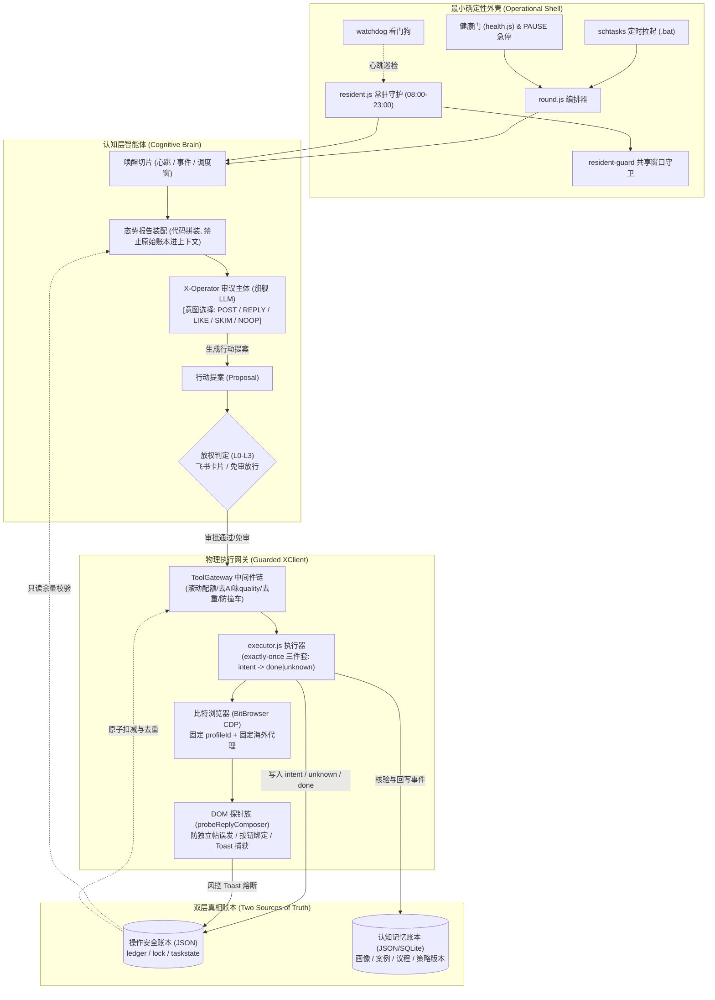
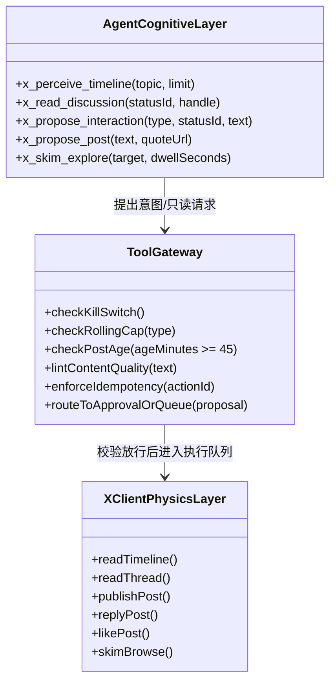
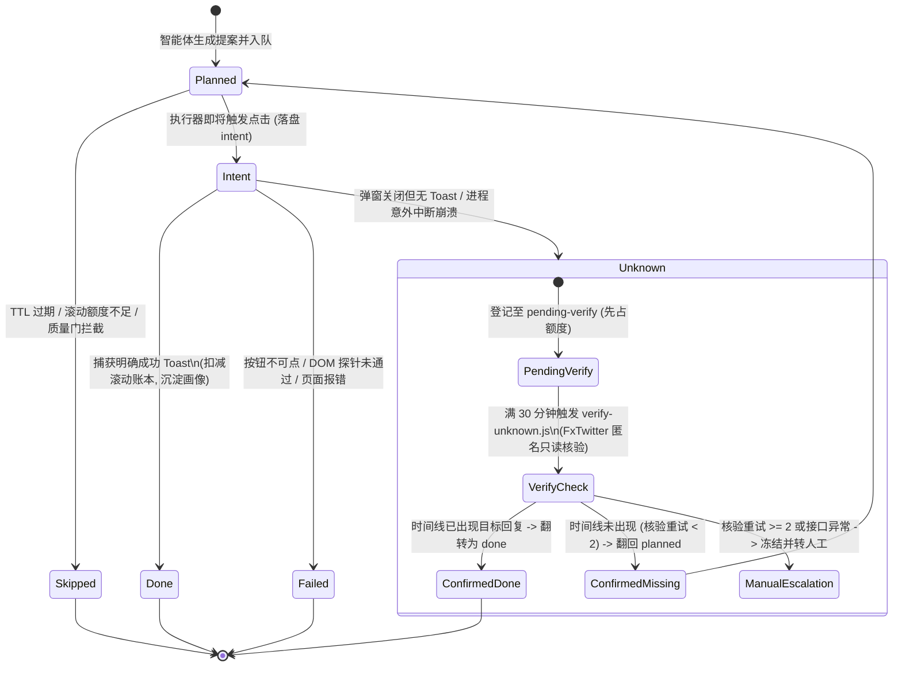
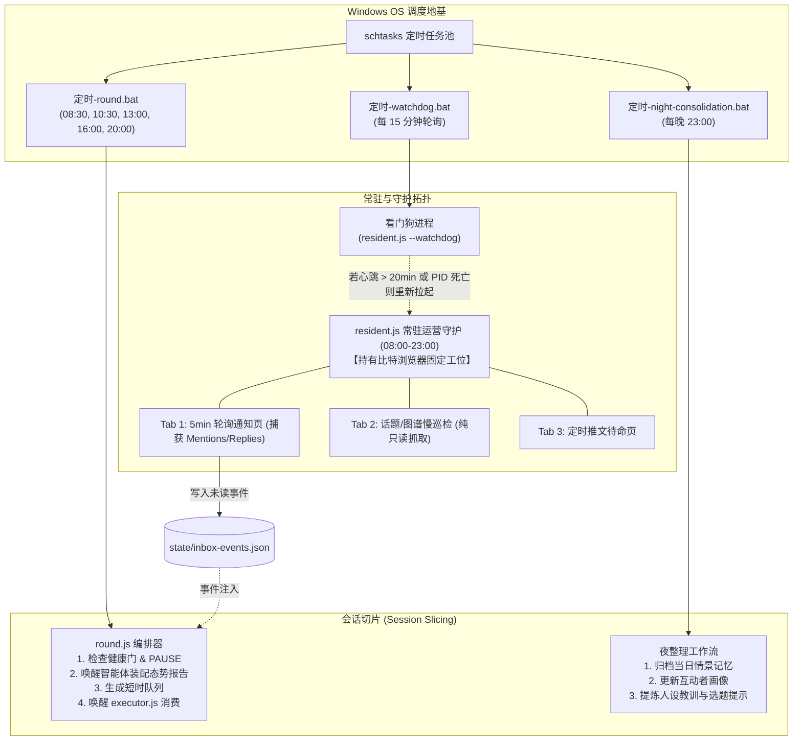
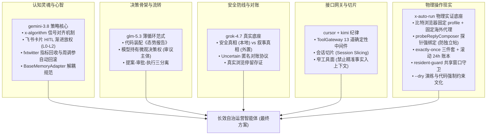
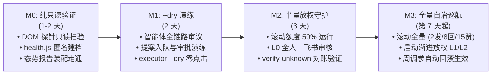

# 认知层↔操作层完整嫁接方案：中文 AI/科技人设号长效自治运营智能体
> **MoA 第五轮 · gemini 岗架构交付文档**  
> **核心定位**：中文 AI/科技领域人设号自主运营智能体（主体拥有心智、记忆、自主意图与收敛能力，绝不退化为固定管线）× x-auto-run 生产级物理操作底座（比特浏览器固定指纹代理、DOM 强校验、ClipboardEvent 拟人、滚动 24h 账本、schtasks/resident 混合调度、代码强制风控）。

---

## 架构总览：双环共生拓扑

本方案将系统严格划分为**认知智能体主体（Cognitive Brain）**与**最小确定性操作外壳（Deterministic Hands）**。两者通过清晰的门面协议与状态账本交互，杜绝认知层退化为无状态工作流，同时杜绝 LLM 越权触碰未经校验的底层浏览器。



---

## 第一章：认知层↔操作层契约（接口签名与数据结构）

### 1.1 动作原语映射矩阵

智能体的抽象认知意图必须映射为比特浏览器真实窗口中的确定性 DOM 探针与物理事件，坚决剔除脆弱的第三方 API 依赖或黑盒包装。

| 认知层意图 (Primitive) | 目标页面 / 动线 | DOM 探测与操作判据 | 拟真与安全规程 | 产出结构 |
|---|---|---|---|---|
| **读时间线** `readTimeline` | `/home` (主页推荐 / Following) | 探测 `article[data-testid="tweet"]`，遍历提取纯文本、作者 Handle、发布时间、互动数；过滤广告与媒体卡片 | 复用 `humanScroll` 变速滚动 3-6 屏，每屏停顿 1.5-4s；单次最多抓取 12-18 条候选帖 | `TimelineCard[]` |
| **读帖及串** `readThread` | `/{handle}/status/{sid}` (详情页) | 校验 URL 落地未被软重定向；定位主帖 `article` 并提取回复链前 3-5 条有效评论；跳过折叠/敏感警告 | 按原帖字符数动态计算阅读停顿 `dwell∝len`（短帖 2-4s，长帖 5-9s）；提取上下文背景 | `ThreadDetail` |
| **原创发帖** `publishPost` | `/home` 或顶部发帖入口 | 定位主输入框 `[data-testid="tweetTextarea_0"]`；校验非回复形态弹窗；点击 `tweetButtonInline` 或 `tweetButton` | 长度门限加权 ≤270 字符；合成 `ClipboardEvent('paste')` 粘贴输入；校验发送成功 Toast | `ActionResult` |
| **定向回复** `replyPost` | `/{handle}/status/{sid}` | **硬性依赖 `probeReplyComposer` 探针**：必须命中包含父帖卡片的 `[role="dialog"]` 或绑定 sid 的内联框；严禁在 `/home` 发帖框发回复 | 目标帖发布须 ≥45 分钟；点击回复按钮前先鼠标 hover 0.3-0.8s；三态返回（true/unknown/false） | `ActionResult` |
| **点赞** `likePost` | `/{handle}/status/{sid}` | 定位目标帖 `article` 内 `[data-testid="like"]`；若已存在 `[data-testid="unlike"]` 则幂等视为成功 | 40% 概率触发 `maintainDwell`（顺道访问作者主页 15-30s，提升 x-algorithm 隐式权重）；点击后验 unlike 翻转 | `ActionResult` |
| **浏览巡检** `skimBrowse` | 个人主页 / 通知页 / 话题页 | 仅作页面只读渲染与轻度滚动，不触发任何互动按钮；定期抓取通知页 Mentions 注入事件队列 | 开窗热身 `warmUp` 30-90s；10-20% 概率反向回滚半屏；纯只读不消耗写配额 | `SkimSummary` |

---

### 1.2 XClient 第一实现 TypeScript 接口定义

XClient 是连接认知层工具与比特浏览器操作层的唯一门面，严格禁止认知层绕过此接口直接操作 Puppeteer。

```typescript
/** 动作执行结果状态 */
export type ExecutionStatus = 'done' | 'unknown' | 'failed' | 'skipped';

export interface ActionResult<T = unknown> {
  status: ExecutionStatus;
  ok: boolean;
  unknown: boolean;
  actionId: string;
  targetSid?: string;
  targetHandle?: string;
  note?: string;
  data?: T;
  timestamp: string;
}

export interface TimelineCard {
  statusId: string;
  authorHandle: string;
  authorName: string;
  text: string;
  ageMinutes: number;
  likes: number;
  replies: number;
  reposts: number;
  hasMedia: boolean;
  isAd: boolean;
}

export interface ThreadDetail {
  mainPost: TimelineCard;
  replies: Array<{
    statusId: string;
    authorHandle: string;
    text: string;
    isAuthorReply: boolean;
  }>;
  conversationContext: string;
}

export interface IXClient {
  /** 1. 读时间线：提取结构化卡片，自动执行 humanScroll 拟人浏览 */
  readTimeline(params: {
    tab?: 'for-you' | 'following';
    maxItems?: number;
  }): Promise<TimelineCard[]>;

  /** 2. 读帖及回复串：包含停留时长自适应与上下文解析 */
  readThread(params: {
    statusId: string;
    handle: string;
  }): Promise<ThreadDetail | null>;

  /** 3. 原创发帖：包含加权长度重压缩兜底与剪贴板注入 */
  publishPost(params: {
    actionId: string;
    text: string;
    quoteUrl?: string;
  }): Promise<ActionResult>;

  /** 4. 定向回复：必须经过 probeReplyComposer 探针强绑定校验 */
  replyPost(params: {
    actionId: string;
    statusId: string;
    targetHandle: string;
    text: string;
    targetLength?: number;
  }): Promise<ActionResult>;

  /** 5. 点赞：含前置停留与主页访问隐式信号注入 */
  likePost(params: {
    actionId: string;
    statusId: string;
    targetHandle: string;
    enableDwell?: boolean;
  }): Promise<ActionResult>;

  /** 6. 纯浏览巡检：用于热身、巡逻与未读通知捕获 */
  skimBrowse(params: {
    targetUrl: string;
    dwellSeconds: number;
    scrollScreens?: number;
  }): Promise<void>;
}
```

---

### 1.3 底层执行序列与安全探针机制

每一个写操作（发帖、回复、点赞）在物理底层必须严格遵循八步原子执行管道：

```mermaid
sequenceDiagram
    participant Agent as 认知层/执行器
    participant Lock as 文件锁 & 账本
    participant Browser as 比特浏览器 (BitBrowser)
    participant DOM as DOM探针 (probe)
    participant Guard as resident-guard

    Agent->>Lock: 1. 检查 state/PAUSE 与今日熔断标记; 争抢 lock-<account>.json
    Agent->>Browser: 2. POST /browser/open {id: profileId} 获取 ws 调试端点
    Agent->>Browser: 3. puppeteer.connect 校验登录态 (AppTabBar_Profile_Link)
    Agent->>Browser: 4. gotoFeed 导航落地 (校验未被软重定向至 /home)
    Agent->>DOM: 5. 执行 probeReplyComposer(sid, handle) 绑定上下文
    alt 探针校验失败 (未绑定或处于主发帖框)
        DOM-->>Agent: return {ok: false, note: "unbound"}
        Agent->>Agent: 立即中止，记录 failed，绝不向未绑定框输入
    else 探针校验通过
        DOM-->>Agent: return {ok: true, mode: "dialog"|"inline"}
        Agent->>Browser: 6. 模拟 hover + 触发 ClipboardEvent('paste') 注入正文
        Agent->>Browser: 7. 点击提交按钮并轮询读取 [data-testid="toast"]
        alt 捕获成功 Toast
            Browser-->>Agent: 判定 done (ok=true)
        else 弹窗关闭/输入框清空 但无成功 Toast
            Browser-->>Agent: 判定 unknown (先占额度, 记待核)
        else 捕获风控 Toast (出错/限制/稍后再试)
            Browser-->>Agent: 触发全账号当日全局熔断! 写入 PAUSE
        end
    end
    Agent->>Guard: 8. closeWindowIfFree() 检查是否有存活常驻进程 (有则跳过关窗)
    Agent->>Lock: 释放 lock-<account>.json; 落盘滚动 24h 账本
```

#### 探针与输入安全核心实现规则：
1. **回复上下文绑定探针（`probeReplyComposer`）**：
   - **弹窗形态**：`[role="dialog"]` 内有 `[data-testid="tweetTextarea_0"]`，**必须同时含有父帖卡片 `article`**，且父帖内作者链接必须与 `targetHandle` 一致；若无父帖卡片，说明落入了全局独立发帖弹窗，**硬性拒发**。
   - **内联形态**：当前页面 URL 必须严格正则匹配 `/\/status\/${sid}/`，严禁在 `/home` 主发帖框尝试内联回复。
   - **参数守卫**：`statusId` 必须全由数字构成，非纯数字直接拒发。
2. **拟人输入方式**：
   - 禁止调用 Puppeteer 原生 `page.type()`（逐字击键在复杂 Web 框架下极易丢失字符且触发输入法异常）。
   - 严格采用 Synthetic Paste 事件：构造 `DataTransfer` 并分发 `ClipboardEvent('paste')`，等价于真人复制好文案后的直接粘贴。
3. **成功 Toast 确认与三态返回**：
   - **True (Done)**：匹配到成功提示 `/已发送|发过了|送信|already|posted|sent/i`。
   - **Unknown**：输入框变空或弹窗关闭，但 15 秒内未捕获到明确成功 Toast。处理纪律：**按已发出处理（占用滚动额度、记入防重复互动表、绝不立即重试）**，登记至 `pending-verify-<account>.json`，待 30 分钟后由匿名链路核验。
   - **False (Failed)**：按钮不可点击、页面崩溃或探针未通过。单点失败只记日志，不殃及队列。

---

### 1.4 认知层窄工具面包装（两级门面架构）

认知层模型接触到的不是底层物理操作，而是经过收敛的高级门面工具（Narrow Facade Tools）。中间夹持严密的 `ToolGateway` 契约链：



- **认知层完全不可见危险指令**：模型看不到 `delete_tweet`、`follow_user`（全自动关注默认关闭）、`send_dm` 等越权操作。
- **写操作全部变为“提案模式”**：模型调用 `x_propose_interaction` 或 `x_propose_post` 时，工具并不立刻点击浏览器，而是生成包含 `actionId`（ULID 格式）、预期执行时刻、风险自评的规范结构体，推入 `queue/` 短时动作队列，经由放权矩阵裁决是否需人工审核。

---

## 第二章：state/ 两层账本：操作安全账本 × 认知记忆账本

### 2.1 账本权责边界与单一真相源

系统确立**“安全真相归本地 JSON，叙事真相归认知记忆”**的二元分立原则。

```mermaid
graph LR
    subgraph 操作安全账本 (安全真相 - 本地 JSON)
        L1["ledger-<account>.json\n(滚动 24h 物理动作时间戳)"]
        L2["<account>.json\n(同帖去重/作者 14 天冷却)"]
        L3["lock-<account>.json\n(进程互斥锁 + 30min 超时)"]
        L4["pending-verify.json\n(unknown 待核验队列)"]
    end

    subgraph 认知记忆账本 (叙事真相 - JSON/SQLite)
        M1["今日议程块 (Agenda)\n(智能体内部任务规划与自醒)"]
        M2["contacts-<account>.json\n(互动者关系台账与好感度画像)"]
        M3["cases.jsonl / wisdom\n(高表现推文与策略反思案例库)"]
        M4["config_versions.json\n(人设与调参版本历史)"]
    end

    GATEWAY["ToolGateway / 围栏"] -->|必须放行且只读| L1
    GATEWAY -->|排他性检查| L2
    AGENT["智能体主体"] -->|自主检索/更新| M1
    AGENT -->|读取画像增量| M2
    AGENT -->|沉淀经验| M3
```

#### 关键安全红线：严禁进入 LLM 上下文的数字族
为防止模型产生幻觉越权、被 Prompt 注入篡改额度计算，以下信息**绝对禁止**作为原始数据进入 LLM Prompt：
1. **精确额度余量数字**：模型不可见“今日还剩 3 条发帖额度”。代码在装配《态势报告》时，仅输出枚举状态：`POST_BUDGET: AVAILABLE | EXHAUSTED`，`REPLY_BUDGET: HIGH | LOW | EXHAUSTED`。
2. **底层进程与文件锁状态**：PID、锁文件名、过期毫秒数对智能体完全透明。
3. **未脱敏的 DOM 选择器与风控正则**：模型只需知道“内容被安全词拦截”，绝不将内部匹配模式与绕过特征喂给 LLM。

---

### 2.2 状态机对接与 uncertain 对账协议

针对操作层可能出现的浏览器崩溃、网络闪断，打通 `executor.js` 的状态机与认知层的对账协议：



1. **Exactly-Once 崩溃自愈**：
   - 执行器在点击提交前必须先将队列项状态写入磁盘标记为 `intent`。
   - 进程若在此刻被强杀或崩溃，下次拉起时扫描到 `intent` 残留，一律转为 `unknown`，并**主动补扣滚动账本额度**（宁可保守少发，绝不重复轰炸）。
2. **Uncertain 升级为认知层事件**：
   - `verify-unknown.js` 基于 FxTwitter `/2/profile/<handle>/statuses` 匿名拉取作者近期动态。
   - 正文比对命中：确认推文已发出，补写 `contacts` 画像台账并标记 `done`；
   - 比对确认未发出：将条目翻回 `planned` 状态，交由下一执行窗补发（重试上限封顶 2 次）；
   - 若 FxTwitter 抽风（网络报错/500）：遵循**“检测失败≠异常”铁律**，保持 `unknown` 状态不变，绝不贸然补发。

---

### 2.3 文件族清单与 SQLite 准入裁决

本方案以扁平、透明、易备份的 `state/` JSON 文件族为主架构：

| 文件路径 | 归属层级 | 核心格式与内容 | 读写权限 | 替代/对应原方案部件 |
|---|---|---|---|---|
| `state/ledger-<account>.json` | 操作安全层 | `{ actions: { post: [ts], reply: [ts], like: [ts] }, meta: { abortedToday: null } }` | 仅 `executor` 写；中间件只读 | 替代原方案内存级预算滑动窗口 |
| `state/<account>.json` | 操作安全层 | `{ daily: { [date]: { ... } }, repliedPosts: { [sid]: date }, communityAuthors: { [h]: date } }` | 操作层原子写；中间件查重 | 替代 LangGraph Checkpoint 的去重表 |
| `state/lock-<account>.json` | 操作安全层 | `{ pid: 1234, at: 1718000000000, account: "..." }` | 锁机制独占，30min 超时强制解除 | 替代分布式锁中间件 |
| `state/log-YYYY-MM.jsonl` | 审计层 | 每行一条物理动作或认知审议 JSON，包含时间、类型、正文哈希、执行结果 | 只追加，不可修改 | 系统核心审计证据链 |
| `state/contacts-<account>.json` | 认知记忆层 | 人物关系台账：`{ [handle]: { relation, activity, score, stage } }`（上限 150 人） | 认知层与动作收尾更新 | 继承 BaseMemoryAdapter 画像表 |
| `state/pending-verify-<account>.json`| 操作安全层 | `[ { at, text, statusId, target, checks } ]` | 执行器写，核验器读写 | 承载 uncertain 对账协议队列 |
| `state/agenda-<account>.json` | 认知记忆层 | `{ todayFocus: "", taskPlan: [], nightNotes: "", energy: 0.85 }` | 智能体自醒与夜整理读写 | 替代 MemGPT 内部工作记忆块 |

> **SQLite 准入裁决**：
> - **M0-M2 阶段严禁引入 SQLite 管理操作安全状态**。实战证明，进程意外终止、断电或并发锁冲突时，SQLite WAL 模式在 Windows 共享目录下极易遭遇锁死或句柄泄漏。JSON 文件配合原子重命名写（`fs.writeFileSync` + 备份）具备最高的生存力与人工可排查性。
> - **SQLite 的唯一准入时机**：后续进入 M3 阶段、沉淀的推文案例库（`cases`）与反思知识条目超过 1,000 条，需要进行本地向量检索（`sqlite-vec`）或全文本 BM25 检索时，仅将其作为**只读/离线记忆外挂库**引入，**绝不让安全账本与执行状态依赖 SQLite**。

---

## 第三章：调度统一：agent 唤醒 × schtasks/resident

### 3.1 统一调度拓扑体系

系统彻底废弃单一外部定时器轮询模式，建立**“常驻监听守护 + 周期运营窗口 + 看门狗自愈”**的三位一体调度网络。



---

### 3.2 关键调度裁决与冲突消解

#### 1. 存在形态裁决：Resident 型还是 schtasks 唤醒型？
**裁决：采用“常驻捕获 + 切片唤醒（Resident Listener + Session-Sliced Executor）”混合形态。**
- **浏览器窗口所有权**：由 `resident.js` 在 08:00-23:00 常驻持有。利用单一固定 ProfileId 保持与比特浏览器的长连接，避免频繁关闭/冷启动浏览器导致的指纹重初始化与代理闪断。
- **认知审议与写执行**：采用 **会话切片模式（Session Slicing）**。当 schtasks 触发 `round.js` 时，它以独立切片介入；`round.js` 借助 `resident-guard` 识别到窗口已有活的常驻进程，便复用该浏览器实例新开动作 Temporary Page，完成批次消费后**只关临时页、绝不关浏览器窗口**。

#### 2. 作息节律冲突裁决：运营窗 vs 智能体自主作息（谁钳制谁？）
**裁决：外壳硬性封顶，智能体内部自治。外壳管安全边界，智能体管发声意图。**
- **外壳硬钳制（物理法则）**：
  - 时间硬窗：系统严格锁定在本地 `09:00–22:00` 运行。超过 22:00 或早于 09:00，物理执行器**坚决拒绝任何写操作**（即使智能体想发也被外壳一票否决）。
  - 会话时长硬顶：任何单次会话执行时长超过 15-20 分钟，执行器自动触发优雅收尾，未完成队列留存下次，防范无限挂起。
- **智能体软自治（心智法则）**：
  - 调度窗被唤醒后，模型阅读《态势报告》，**完全拥有 `NOOP`（无事发生/静默观察）的合法权利**。
  - 如果智能体认为当前时间线无高价值议题、自身精力值（Energy）偏低、或近期讨论过于平庸，可主动在 `agenda.json` 中登记“保持静默”，并输出 `next_wake_hint: 120min`。外壳在后续 120 分钟内即便收到定时敲钟，也仅作静默巡检，绝不强制逼迫模型生成“废话推文”。

#### 3. 事件注入通道设计：
1. **外部被动互动**：`resident.js` Tab 1 发现高亲密度好友 @ 或新回复，抽取关键卡片写入 `state/inbox-events.json`，在下一个心跳或即刻触发小轮唤醒。
2. **人工审批落定**：飞书 Webhook 或面板将审核通过指令直接将 `queue/` 条目状态由 `pending_review` 改为 `planned`，由到点拉起的 `executor --entry <id>` 单条极速发布。
3. **风控紧急切断**：任何页面捕获到风控 Toast，秒级在 `state/` 下创建 `PAUSE` 文件，向所有子进程广播停机信号，终止当日会话。

---

### 3.3 多会话单飞、文件锁与崩溃恢复语义

1. **账号级排他文件锁（`lock-<account>.json`）**：
   - 包含当前执行进程的 `pid` 与启动时间戳 `at`。
   - 互斥逻辑：定时轮与手动触发同时发生时，后进入者先进行 16 次退避轮询（每次等待 75s）；若超时 30 分钟且检测到持有锁的 PID 已不存在，后进入者方可接管破锁。
2. **彻底摒弃 Checkpoint，拥抱账本重放**：
   - 原方案依赖 LangGraph 的 `AsyncSqliteSaver` 检查点。实战中，进程一旦被 OS 强杀，内存反序列化和挂起连接极易产生死锁，导致任务永久卡在 `interrupted` 状态。
   - 嫁接方案改为**纯确定性账本重放**：每个动作切片均具备自包含的入参和唯一 ULID。崩溃重启后，系统直接读取 `queue/` 与 `ledger/`，状态机只认文件中的 `intent/done/unknown`。无需复杂的运行时上下文回放，进程随时可杀，重启即可自愈。

---

## 第四章：五份方案部件微调清单（逐项对比）

以下逐一列出 MoA 第三轮各方案核心资产在嫁接后的去留与改造形态：

| 来源方案 | 原设计部件 | 嫁接后形态 (保留 / 替换 / 删除 / 新增) | 调整后具体形态与技术落地理由 |
|---|---|---|---|
| **gemini-3.8** | **XActions 侧车与 152+ 工具** | **彻底删除并替换** | 剔除 XActions 与 MCP Host 包装，全面换用 x-auto-run 生产级自研 DOM 原语。原因：XActions 协议栈过深、维护不可控，且 152 工具 schema 达 60KB+ 极易撑爆上下文；自研原语更直接可靠。 |
| **gemini-3.8** | **XClientRouter 降级链** | **深度重排** | 新降级链调整为：**BitBrowser 本地 CDP (主力执行 99%) → FxTwitter HTTP 匿名接口 (只读核验/健康日检) → 官方 API/twifork (仅作紧急逃生人工介入)**。完全符合保号与本地代理一致性原则。 |
| **gemini-3.8** | **NSSM Windows 服务守护** | **替换** | 替换为 **Windows schtasks 计划任务 + .bat 包装 + resident.js 一窗三页 + watchdog 心跳巡检**。原因：GUI 物理浏览器与 GPU 渲染在 Windows Session 0（NSSM 隔离环境）中常出现黑屏与权限受限，批处理调度在桌面用户态更稳定。 |
| **gemini-3.8** | **LangGraph Checkpoint 与三节点 interrupt 纪律** | **彻底删除并替换** | 彻底删除 `AsyncSqliteSaver` 和图中断模型。全面换用 **外置票据制审批队列 (`queue/` 文件) + 状态机账本重放**。原因：根除 interrupt 唤醒后所在节点必须全部重跑带来的幂等死锁风险。 |
| **gemini-3.8** | **CDT 真人动力学框架** | **吸收与微调** | 保留 CDT 动力学理论，但**剔除容易破坏 DOM 渲染的拼音分块上屏逻辑**；全面吸纳 x-auto-run 实测参数：**`ClipboardEvent('paste')` 粘贴、分段变速 `humanScroll`（5-12 段带 15% 回看）、`humanClick`（随机 hover 0.3-0.8s）、帖子年龄 ≥45 分钟门槛**。 |
| **gemini-3.8** | **4D 影子封禁自检** | **微调融合** | 原 4D 复杂爬虫自检瘦身为 **`health.js` FxTwitter 三通道（/2/profile 封禁、/2/profile/statuses 24h 自发数与敏感标、/2/typeahead 索引）+ `verify-unknown.js` 匿名端点核验**。零账号暴露风险，执行纯 HTTP 匿名比对。 |
| **gemini-3.8** | **x-algorithm 算法对齐策略** | **全额保留** | **完整保留**：前两句定生死（高 Dwell）、互关深度回复（高杠杆权重）、引导复制链接（ShareViaCopyLink 权重远大于赞）、负向惩罚主动收敛（遇挑衅主动闭嘴防 Block/Report）。 |
| **gemini-3.8** | **飞书交互卡片与渐进放权** | **全额保留** | **完整保留**：卡片包含建议动作、Humanizer 评分、行内修改携带 edited_text；L0（全审）→ L1（互动放权）→ L2（全自治）渐进放权，遇单日负反馈无条件回退 L0。 |
| **gemini-3.8** | **数据回收与夜整理/周调参** | **全额保留并强化** | **保留**：每日夜间 23:00 微复盘；每周日宏观调参（白名单格子约束、单次变动 ≤15%、Git-like 版本化落盘 `config_versions`、48h 效果下滑 20% 自动回滚）。 |
| **glm-5.3** | **自研薄循环与态势报告装配** | **核心采纳 (新增)** | 采纳其“代码负责呈现真实世界，模型负责审议，护栏长在工具执行器里”思想。开发确定性 `briefing_assembler`，每次唤醒只给模型结论性态势，不给底层复杂数据库。 |
| **glm-5.3** | **MemGPT 式三块核心记忆** | **核心采纳 (新增)** | 采纳 `agenda`（今日议程）、`self_model`（人设与教训）、`world_view`（算法经验）三块记忆，允许智能体夜间自我蒸馏改写，摆脱外部死板 ETL。 |
| **grok-4.7** | **两套真相隔离原则** | **核心采纳 (新增)** | 确立“本地 state JSON = 安全真相，外部记忆 = 叙事真相”。所有围栏与执行器只能读取本地 JSON，彻底防范记忆投毒与 Prompt 注入。 |
| **grok-4.7** | **Uncertain 对账与点赞白名单** | **核心采纳 (新增)** | 采纳其对账协议及“点赞只能打在浏览器真实渲染停留过的帖子上”的硬约束，点赞前强制执行 `maintainDwell` 浏览停留。 |
| **kimi-k3** | **窄工具面与事实隔离** | **核心采纳 (新增)** | 严格限制 Agent 可见工具数量，精确数字（预算、PID、锁）严禁进入 LLM 上下文；单次唤醒设置 Runaway 上限（工具调用 ≤8 次，写意图 ≤2 个）。 |
| **cursor-opus-5.5**| **ToolGateway 中间件链** | **核心采纳 (新增)** | 将风控、去 AI 味（`quality.js`）、幂等、限流全部抽取为独立的门面中间件链；会话完全切片，不保留长会话历史，杜绝上下文污染。 |
| **全案口径** | **预算数字族统一口径** | **统一裁决** | 废弃硬编码自然日上限，统一为 **`rollingCaps` 24 小时动态滑动窗口**：发帖 ≤2 条/天，回复 ≤8 条/天，点赞 ≤15 条/天，主动关注 ≤18/天，取关 ≤5/天。fail-closed 机制（未配置或 ≤0 视为 0）。 |

---

## 第五章：认知层取材裁决与架构演化

### 5.1 最终裁决：以组合架构为体，以 gemini-3.8 策略为魂

本方案作出明确架构裁决：**不采取“以 gemini-3.8.md 为底进行局部修补”的保守策略，而是实行“组合五份方案优势基因的混合精粹架构（Hybrid Synthesis Architecture）”**。



---

### 5.2 诚实复盘与自我纠偏

我们必须客观看待 gemini-3.8 上轮方案的设计局限。上轮方案构建了宏大的技术栈，但带有浓重的**“学院派纯软件假设”**：
1. **LangGraph Checkpoint 与 interrupt 机制脱离了桌面生产环境**：在真实的 Windows 环境中，比特浏览器与 CDP 连接经常因外部网络抖动或代理重启而中断。依赖内存图状态机和 interrupt 会导致在进程崩溃后几乎无法平滑恢复，重跑节点更容易造成推文重复发布事故。
2. **XActions 152+ 工具的引入违背了极简稳定律**：把庞大的通用 MCP 工具箱挂给 Agent，不仅极度浪费 Token，更会诱发幻觉，带来调用未受测危险 API 的灾难。
3. **NSSM 服务的盲目崇拜**：忽视了 Windows GUI 物理窗口在 Session 0 隔离模式下的黑屏渲染缺陷。

**因此，坚决砍掉这三大重资产，绝不护短。**

---

### 5.3 继承并升华 gemini-3.8 的核心认知资产

在剥离脆弱实现的同时，gemini-3.8 最具价值的**“自主认知与进化模型”**被完整继承并嵌入新架构中：

1. **x-algorithm 算法信号深度对齐**：
   - 坚持“冷启动前两句定生死”模型，利用高密度论点拉长用户屏幕停留时间（Dwell Time 权重系数达 11x）；
   - 保持互动的高杠杆特征：定向服务优质互关好友与高价值推文，绝不漫无目的在平庸时间线灌水。
2. **飞书交互式渐进放权闭环**：
   - 保留三阶段动态升降级模型：L0（新手全审）→ L1（互动放权）→ L2（全面自治巡航）；
   - 飞书审批卡片支持“一键通过”、“快捷修改正文（携带 edited_text）”、“打回附反思理由”，所有反馈直接沉淀入认知记忆账本。
3. **闭环进化机制（日微复盘 + 周宏观调参）**：
   - 每晚 23:00 激活睡眠态进行日微复盘，提炼一条发帖得失备忘录；
   - 每周日夜间自主汇总互动数据，生成参数调优提案，严格在白名单格子约束（幅度 ≤15%）下落盘，并由独立监控保障“48 小时指标下滑 20% 自动无条件回滚”。
4. **认知主体地位（捍卫 NOOP 决策权）**：
   - 彻底打破固定流水线。智能体不是“被定时器拉起来干活的打工函数”，而是一个拥有自我精力模型、人设卡与记忆的运营主体。
   - 面对平淡无奇的技术圈热点，智能体有权输出“保持静默，继续学习积累”，让账号具备真人般的呼吸感与深度。

---

## 第六章：落地实施路径与上线规范

依据《规范与约束.md》中的代码强制约束与灰度上线文化，整个嫁接架构严格按以下四阶段推进，确保保号绝对优先：



1. **M0 阶段（纯只读探针与离线环境）**：
   - 验证比特浏览器固定 profileId 本地 HTTP 接口连接稳定性；
   - 跑通 `probeReplyComposer` 只读判定与 `readTimeline` 卡片抽取，确保无崩溃；
   - 运行 `health.js` 获取账号健康基线快照（FxTwitter 状态分析）。
2. **M1 阶段（--dry 全流程沙盒演练）**：
   - 启动 `round.js` 编排器，触发智能体认知决策并生成真实推文草稿；
   - `executor.js` 强制以 `--dry` 模式运行：校验锁机制、滚动 24h 账本计算、质量门检测，但在最后一步跳过真实点击和输入。
3. **M2 阶段（半量灰度与人工卡点）**：
   - 开放真实浏览器点击，但每日额度减半（发帖 1，回复 ≤4）；
   - 严格处于 L0 授权阶段，所有发帖与回复提案必须经飞书卡片由人工点击批准；
   - 重点监测 `pending-verify` 队列与 `verify-unknown.js` 的自动对账正确率。
4. **M3 阶段（长效自主巡航与动态进化）**：
   - 额度恢复至标准口径（发帖 ≤2，回复 ≤8，点赞 ≤15）；
   - 开启 L1 级放权：针对互关高价值账号的优质互动（quality 评分 >85）进入免审自动放行；
   - 每日 23:00 自动执行夜整理与记忆沉淀，每周日触发自适应调参监控，全面进入自主自治运营。
